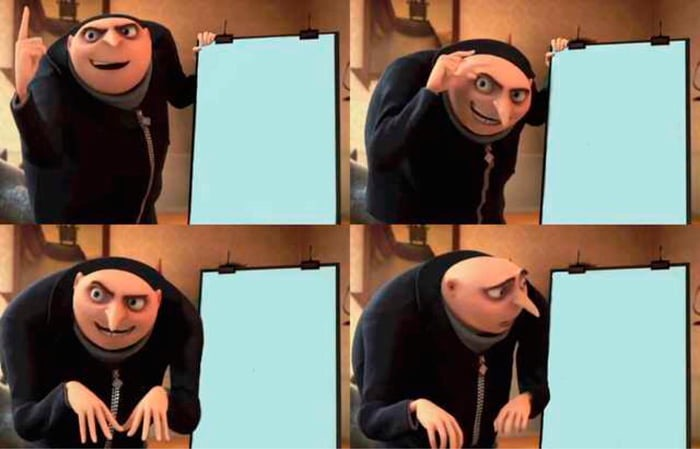

# DESIGN.md: fundação do site de apresentação

> Oficina de Desenvolvimento com IA. Slides servidos como site no GitHub Pages.
> Versão 1.37 · 2026-11-17 · Leandro Amaral

Este arquivo é a **fonte da verdade** do projeto. Ele vale para quem escreve código à mão e para agentes de IA (OpenCode, Claude, Copilot). Faça o `AGENTS.md` do repositório apontar para cá, com a linha: *"Antes de criar ou alterar qualquer slide, leia o DESIGN.md e siga-o à risca."*

Se algo aqui estiver errado ou faltando, **corrija este arquivo primeiro** e só depois o código. É a mesma regra de ouro que a oficina ensina.

---

## 1. Objetivo e escopo

- **O que é:** um site estático com as apresentações dos dois dias da oficina, construído com reveal.js e publicado no GitHub Pages.
- **Por que site e não PowerPoint:** a identidade visual depende de animação, CSS e efeitos em canvas, que se perdem em .pptx ou PDF.
- **De onde vem o conteúdo:** do documento *Roteiro Final, Oficina de Desenvolvimento com IA*. Este arquivo define só **forma e regras**. O roteiro define **o que** cada slide diz.
- **Fora do escopo:** backend, login, analytics e frameworks de UI (React, Vue etc.).

## 2. Stack e restrições

| Item | Decisão |
|---|---|
| Motor de slides | **reveal.js 6.0.1**, carregado do cdnjs. A versão é fixa e nunca vira `latest` |
| Build | **Nenhum.** HTML, CSS e JS puros, abertos direto no navegador |
| Tema do reveal.js | **Nenhum tema pronto.** Só `reset.css` e `reveal.css`; o tema é nosso (seção 6) |
| Plugins | `RevealNotes` (notas do apresentador) e `RevealHighlight` (código), só se houver código |
| Fontes | Google Fonts: Anybody, DM Sans e Space Mono |
| Hospedagem | GitHub Pages, a partir da branch `main`, pasta raiz |
| Navegadores-alvo | Chrome e Edge atuais (projetor do laboratório). Firefox e Safari só precisam funcionar razoavelmente |

URLs base (cdnjs, reveal.js 6.0.1):

```html
<link rel="stylesheet" href="https://cdnjs.cloudflare.com/ajax/libs/reveal.js/6.0.1/reset.min.css">
<link rel="stylesheet" href="https://cdnjs.cloudflare.com/ajax/libs/reveal.js/6.0.1/reveal.min.css">
<!-- NÃO carregar nada de /theme/ -->
<script src="https://cdnjs.cloudflare.com/ajax/libs/reveal.js/6.0.1/reveal.min.js"></script>
<script src="https://cdnjs.cloudflare.com/ajax/libs/reveal.js/6.0.1/plugin/notes.min.js"></script>
```

```html
<link rel="preconnect" href="https://fonts.googleapis.com">
<link rel="preconnect" href="https://fonts.gstatic.com" crossorigin>
<link rel="stylesheet" href="https://fonts.googleapis.com/css2?family=Anybody:wdth,wght@50..150,100..900&family=DM+Sans:ital,wght@0,400..700;1,400..700&family=Space+Mono:wght@400;700&display=swap">
```

> **Atualizar o reveal.js:** trocar o número da versão em todos os links ao mesmo tempo, testar os dois dias inteiros e registrar a mudança no histórico (seção 16). A série 6.x mudou os caminhos de plugins em relação à 5.x, então nunca misture versões.

## 3. Estrutura de arquivos

```
/
├── index.html            # página inicial: título da oficina + dois cartões, um para cada dia
├── dia-1.html            # apresentação do Dia 1 (Um prompt só)
├── dia-2.html            # apresentação do Dia 2 (O jeito estruturado)
├── referencia-ui.html    # deck de referência de UI (todas as peças); NÃO apagar, NÃO linkar: acesso só pela URL
├── certificado-b.html    # certificado de participação (seção 18)
├── css/
│   ├── tokens.css        # variáveis: cores, tipografia, espaços, movimento (seção 5)
│   ├── base.css          # neutraliza padrões do reveal.js + estilos globais (seção 6)
│   ├── componentes.css   # peças reutilizáveis (seção 8)
│   ├── layouts.css       # esqueletos de slide (seção 9)
│   └── animacoes.css     # keyframes, fragments customizados, reduced-motion (seção 10)
├── js/
│   ├── main.js           # Reveal.initialize + liga/desliga efeitos por slide
│   └── efeitos/
│       ├── esfera.js     # esfera pontilhada (canvas): referência de UI e certificado
│       ├── codigo.js     # prompt que vira cascata de código (canvas): capa do Dia 1
│       ├── planta.js     # peças traçadas e construídas em sequência (canvas): capa do Dia 2
│       ├── malha.js      # duas esferas em wireframe (canvas): janela de contexto
│       ├── rede.js       # malha azul que respira (canvas): figura do MCP
│       └── flutuantes.js # quadrados flutuantes
├── assets/
│   ├── img/              # imagens e capturas (PNG/WebP/SVG); memes parados em img/memes/ (8.29)
│   ├── svg/              # ilustrações e diagramas
│   └── video/            # cenas de filme recortadas (8.29): .webm + .mp4 + pôster .png
├── .nojekyll             # evita o processamento Jekyll do GitHub Pages
├── AGENTS.md             # aponta para este DESIGN.md
└── DESIGN.md
```

Regras:

- **Referência de UI:** `referencia-ui.html` guarda o deck de validação visual. Antes de criar um slide, procure ali a peça equivalente e copie o padrão. Ele não aparece na home nem em nenhum outro link.
- **Uma apresentação por arquivo HTML.** Os slides ficam em `<section>` dentro de `.slides`, com um comentário antes de cada bloco do roteiro, por exemplo `<!-- 1.3 Harness -->`.
- **Nunca** coloque estilo inline nos slides. Exceções: posição de um elemento fixado num layout e variáveis CSS locais (`style="--delay: 200ms"`).
- Os arquivos CSS são carregados nesta ordem: `tokens` → `base` → `componentes` → `layouts` → `animacoes`.

## 4. Inicialização do reveal.js

`js/main.js`:

```js
Reveal.initialize({
  width: 1920,
  height: 1080,
  margin: 0,            // o respiro é responsabilidade do nosso layout
  minScale: 0.2,
  maxScale: 2.0,
  center: false,        // nada de centralização vertical automática
  hash: true,           // URL com o número do slide (#/3)
  slideNumber: 'c/t',
  showSlideNumber: 'speaker',
  controls: true,
  controlsLayout: 'bottom-right',
  progress: true,
  transition: 'fade',
  transitionSpeed: 'default',
  backgroundTransition: 'fade',
  autoAnimate: true,
  fragments: true,
  plugins: [RevealNotes]
});

// Efeitos pesados rodam só no slide visível (seção 10.4)
Reveal.on('ready', syncEffects);
Reveal.on('slidechanged', syncEffects);
```

O canvas é sempre **1920×1080**, e o reveal.js escala para a tela. Todas as medidas desta especificação estão nessa escala.

## 5. Tokens (`css/tokens.css`)

### 5.1 Cores

Os matizes vêm do site da Mux: carvão e cinza-esverdeado de base, com um acento principal âmbar e cinco cores de apoio (laranja, rosa, azul, verde e violeta). A **intensidade** vem da Greptile: os acentos são um pouco menos vívidos, quase pastéis, e cada um tem um **tom claro** para o par "cor cheia + tom claro" das figuras (8.21).

```css
:root {
  /* Base */
  --c-ink:        #151617;  /* texto sobre qualquer cor de acento; quase preto */
  --c-basalt:     #242628;  /* superfície escura principal (carvão); texto sobre claro */
  --c-basalt-2:   #3B3E42;  /* chips sobre basalt */
  --c-paper:      #E2E4DD;  /* fundo claro principal (cinza-esverdeado) */
  --c-sand:       #F4F6F4;  /* texto claro sobre escuro */
  --c-white:      #FFFFFF;  /* cartões claros */
  --c-line:       #C4C7BB;  /* bordas e hachuras sobre claro */
  --c-eggshell:   #C2CBD5;  /* texto secundário sobre escuro */
  --c-muted:      #4A525A;  /* texto secundário sobre claro */
  --c-muted-dark: #A3ACB6;  /* texto terciário sobre escuro */

  /* Acentos (intensidade da Greptile) */
  --c-accent:     #FFC247;  /* acento principal (âmbar) */
  --c-tint:       #FFF1CC;  /* títulos sobre escuro; tom claro do âmbar */
  --c-orange:     #FF8650;  /* alerta / erro / "quebrou" */
  --c-pink:       #FF9FDC;  /* marcador rosa; "zona de perda" */
  --c-blue:       #5C8DFF;  /* marcador azul; links, informação e malhas */
  --c-green:      #2FDB8F;  /* marcador verde; "funcionou" */
  --c-violet:     #B497FF;  /* sexta cor de apoio; usada para dar cor própria ao 6º robô (Modelo) */

  /* Tons claros (par "cor cheia + tom claro" das figuras) */
  --c-orange-claro: #FFDCC8;
  --c-pink-claro:   #FFD9F2;
  --c-blue-claro:   #D3DFFF;
  --c-green-claro:  #C5FFD6;  /* menta da Greptile */
  --c-violet-claro: #E5DBFF;

  /* Linhas utilitárias */
  --grid-line-light:  rgba(36, 38, 40, 0.07);
  --grid-line-dark:   rgba(244, 246, 244, 0.06);
  --grid-line-accent: rgba(36, 38, 40, 0.10);
  --frame-dark:       rgba(244, 246, 244, 0.25);
}
```

**Pares aprovados** (contraste WCAG medido; só use texto nestes pares):

| Texto | Fundo | Contraste | Uso |
|---|---|---|---|
| `--c-basalt` | `--c-paper` | 11.8:1 | texto padrão em slide claro |
| `--c-basalt` | `--c-white` | 15.2:1 | texto em cartão claro |
| `--c-muted` | `--c-paper` | 6.2:1 | legendas, fontes, rodapé |
| `--c-tint` | `--c-basalt` | 13.5:1 | títulos em slide escuro |
| `--c-basalt` | `--c-*-claro` | 11.4 a 13.5:1 | texto sobre tom claro (figuras, eyebrow marcado) |
| `--c-sand` | `--c-basalt` | 14.0:1 | corpo em slide escuro |
| `--c-eggshell` | `--c-basalt` | 9.3:1 | texto secundário escuro |
| `--c-muted-dark` | `--c-basalt` | 6.6:1 | texto terciário escuro |
| `--c-accent` | `--c-basalt` | 9.4:1 | rótulos e destaques no escuro |
| `--c-ink` | `--c-accent` | 11.3:1 | texto em slide de acento e pílulas |
| `--c-ink` | `--c-orange` / `--c-pink` / `--c-blue` / `--c-green` / `--c-violet` | 7.6 / 9.7 / 5.8 / 10.1 / 7.6:1 | texto em chips e marcadores coloridos |
| `--c-orange`, `--c-green`, `--c-pink`, `--c-blue`, `--c-violet` | `--c-basalt` | 6.3 / 8.4 / 8.1 / 4.9 / 6.4:1 | texto de alerta ou rótulo colorido no escuro (a partir de 24px) |

**Proibido:** texto na cor de acento (ou de qualquer cor de apoio) sobre fundo claro (âmbar sobre paper: 1.25:1). No claro, essas cores só aparecem como **preenchimento** (pílula, chip, marcador, cartão destaque) com texto `--c-ink` por cima.

**Intensidade.** Nada de cor de apoio saturada "pura" (como o `#0091FF` ou o `#00BE43` das versões antigas): a cor cheia é a do token, e fundos de linha de diff, faixas e áreas grandes usam a cor do token misturada (`color-mix`) ou o tom claro. Cor nova entra já nessa intensidade.

**Uso das cores de apoio:** laranja = problema ("quebrou"), verde = ok ("funcionou"), rosa e azul = categorias e marcadores. Cor nunca é o único sinal (seção 13): sempre há um rótulo de texto junto.

### 5.2 Tipografia

| Papel | Família | Peso | Largura | Caixa | Tracking |
|---|---|---|---|---|---|
| Display (capa, frase de efeito) | Anybody | 700 | 100% | Frase | −0.025em |
| Título de slide (h2) | Anybody | 700 | 100% | Frase | −0.03em |
| Título de cartão (h3) | Anybody | 700 | 100% | Frase | −0.03em |
| Corpo | DM Sans | 400; ênfase 600 | — | Frase | 0 |
| Citação grande | DM Sans | 600 | — | Frase | −0.04em |
| Rótulo, chip, código, rodapé | Space Mono | 400 | — | MAIÚSCULAS | 0.08em |

```css
:root {
  --f-display: 'Anybody', 'Arial Black', sans-serif;
  --f-body:    'DM Sans', Arial, sans-serif;
  --f-mono:    'Space Mono', ui-monospace, monospace;

  /* Escala (canvas 1920×1080). Nada abaixo de 24px. */
  --t-display: 120px;  /* line-height 1.02 */
  --t-h1:      96px;   /* line-height 1.05 */
  --t-h2:      64px;   /* line-height 1.10 */
  --t-h3:      44px;   /* line-height 1.10 */
  --t-lead:    36px;   /* line-height 1.35 */
  --t-body:    28px;   /* line-height 1.45 */
  --t-label:   24px;   /* line-height 1.40 */
}
```

Regras:

- **No máximo 3 tamanhos por slide**, sem contar rótulos. Para dar ênfase, use peso, cor ou itálico, nunca um tamanho novo.
- **Títulos no estilo da Greptile:** Anybody 700 em largura normal, caixa de frase (só a primeira letra e nomes próprios em maiúscula) e tracking negativo. Escreva o título no HTML já em caixa de frase; o CSS não muda a caixa. A classe `title-long` continua aceita, mas hoje é igual ao título padrão.
- **Estimativa de largura:** cerca de 0,55 × tamanho da fonte por caractere. Uma linha de 1664px comporta uns 48 caracteres a 64px e uns 25 a 120px. Se não couber, quebre a linha com `<br>` num ponto natural.
- Rótulos de seção ("eyebrow") vêm **entre colchetes**: `[ VISÃO GERAL ]`.

### 5.3 Espaço, grade e forma

```css
:root {
  --s-1: 8px;  --s-2: 16px; --s-3: 24px; --s-4: 32px;
  --s-5: 48px; --s-6: 64px; --s-7: 96px; --s-8: 128px;

  --slide-pad: 128px;       /* margem interna do slide → área útil 1664×824 */
  --frame-inset: 64px;      /* moldura tracejada */
  --grid-cell: 48px;        /* quadriculado */

  --radius-0: 0;            /* padrão: cantos retos (Greptile) */
  --radius-pill: 999px;     /* pílulas (Mux) */
  --hatch: repeating-linear-gradient(-55deg, var(--c-line) 0 1px, transparent 1px 4px);
}
```

- **Hachura da Greptile:** linhas de 1px a −55°, com 3px de vão. É fina e densa, quase uma textura.
- **Cantos retos são a regra.** O arredondamento fica só nas pílulas e nos pontos dos conectores.
- **Sem sombras.** A profundidade vem de hachura, borda de 1px e contraste de superfície.

### 5.4 Movimento

```css
:root {
  --ease-out:  cubic-bezier(0.2, 0.8, 0.2, 1);
  --ease-io:   cubic-bezier(0.65, 0, 0.35, 1);
  --d-fast:    200ms;   /* hover, cursor */
  --d-base:    450ms;   /* fragments, cartões */
  --d-slow:    900ms;   /* títulos blur-in, conectores */
  --stagger:   120ms;   /* atraso entre itens de uma sequência */
}
```

## 6. Neutralizar os padrões do reveal.js (`css/base.css`)

O `reveal.css` cuida do mecanismo (posição, escala, transições, fragments). Os padrões visuais que ele ainda aplica precisam ser anulados **no início** do `base.css`:

```css
.reveal-viewport { background: var(--c-paper); }

.reveal {
  font-family: var(--f-body);
  font-size: var(--t-body);
  color: var(--c-basalt);
}

.reveal .slides { text-align: left; }

.reveal .slides > section,
.reveal .slides > section > section {
  width: 1920px;
  height: 1080px;
  padding: var(--slide-pad);
  box-sizing: border-box;
  /* NÃO definir display aqui: o reveal.js controla display dos sections */
}

/* O layout vive num wrapper interno (ver aviso abaixo) */
.reveal .slides section > [class^="layout-"] {
  width: 100%;
  height: 100%;
  display: flex;
  flex-direction: column;
  position: relative;
}

.reveal h1, .reveal h2, .reveal h3, .reveal p, .reveal ul, .reveal ol {
  margin: 0;
  text-transform: none;
  text-shadow: none;
  letter-spacing: 0;
  word-wrap: normal;
}

.reveal ul, .reveal ol { padding-left: 1.2em; display: block; }
.reveal img { max-width: none; max-height: none; margin: 0; }
.reveal a { color: inherit; }

/* Controles e barra de progresso na nossa paleta */
.reveal .controls { color: var(--c-accent); }
.reveal .progress { color: var(--c-accent); height: 4px; }
```

> **Atenção à visibilidade:** o reveal.js esconde slides inativos com `display:none` e mostra o atual com `display:block`. Sempre que um layout precisar de `display:flex` ou `grid`, aplique na **classe do layout com `.present`** (ou num `<div class="frame">` interno que ocupe o slide inteiro), nunca force `display` em todos os `section`. O jeito mais seguro é um wrapper interno:
>
> ```html
> <section class="surface-light"><div class="layout-cover"> … </div></section>
> ```
>
> Assim o `section` continua sob controle do reveal.js, e o `div` cuida do layout (`width:100%; height:100%; display:flex`). **Siga este padrão em todos os slides.**

## 7. Superfícies (fundos de slide)

Cada slide tem **exatamente uma** classe de superfície no `section`. A textura e os trilhos fazem parte da superfície e vêm de graça: nenhum slide escreve isso no HTML.

**Fundo no estilo da Greptile.** O miolo do slide é liso, com **granulado** fino (ruído `feTurbulence` em SVG, ~5% de opacidade). O quadriculado de 48px saiu. A estrutura aparece em volta:

- **Trilhos:** duas linhas verticais tracejadas de 1px, a `--frame-inset` (64px) das bordas, na cor `--s-rule`, com um **nó** quadrado de 10px no alto e na base de cada trilho (`section::before` e `section::after`).
- **Calha:** fora dos trilhos (os 64px de cada lado), um quadriculado fino de 8px em `--grid-line-*`. É o único quadriculado do slide.
- Slide com `.frame` (moldura com losangos, 8.6) já tem a sua moldura e esconde os trilhos.

| Classe | Fundo | Texto | Linhas | Quando usar |
|---|---|---|---|---|
| `surface-light` | `--c-paper` | `--c-basalt` | `--grid-line-light` | **padrão de todo o deck**: capa, conteúdo, tabelas, cartões |
| `surface-dark` | `--c-basalt` | `--c-sand`; títulos `--c-tint` | `--grid-line-dark` | só abertura de bloco, para marcar o ritmo (veja a regra da projeção abaixo); **no máximo 1 a cada ~4 slides** |
| `surface-accent` | `--c-accent` | `--c-ink` | `--grid-line-accent` | frase de efeito; **no máximo 1 a cada ~10 slides** |

```css
.surface-light {
  background-color: var(--c-paper);
  background-image: var(--grain);   /* granulado; nada de quadriculado no miolo */
}
/* trilhos, nós e calha: .reveal .slides > section[class*="surface-"]::before / ::after */
/* surface-dark e surface-accent: mesmo padrão, trocando as variáveis */

/* Cada superfície também define variáveis de tema que os layouts consomem,
   para o mesmo layout funcionar em qualquer fundo (nunca escreva cor fixa
   de claro ou de escuro dentro de um layout): */
/* --s-title (títulos), --s-sub (subtítulo), --s-meta (texto de apoio mono),
   --s-rule (linha tracejada), --s-eyebrow (rótulo e losangos), --s-num (número
   grande), --s-dot e --s-glow (esfera e seu brilho) */
```

> Use `data-background-color` do reveal.js **junto** com a classe (`data-background-color="#242628"`) para que o fundo da viewport acompanhe a transição.

**Regra da projeção.** O deck é lido num telão, do fundo da sala. Texto em fundo escuro perde leitura na projeção, então o escuro fica para slides de título grande e pouco texto (a abertura de bloco). Slide com frase, lista, código ou instrução para a turma (inclusive demo e mão na massa) vai no claro. Na dúvida, claro.

## 8. Componentes (`css/componentes.css`)

Cada componente tem uma classe. Variações usam modificador `--`. Os nomes de classe ficam em inglês, e conteúdo e comentários em português.

### 8.1 Eyebrow (rótulo de seção)

```html
<p class="eyebrow">[ VISÃO GERAL ]</p>
```

Space Mono 24px, maiúsculas, tracking 0.08em, cor `--s-eyebrow` da superfície (`--c-basalt` no claro, `--c-accent` no escuro, `--c-ink` no âmbar). Opcionalmente leva cursor piscante: `<span class="cursor" aria-hidden="true"></span>`, um bloco de 14×30px com cor `--c-accent` e animação `blink` de 1s em `steps(1)`.

**Eyebrow marcado** (`.eyebrow--marca`): o rótulo ganha fundo `--c-tint` e texto `--c-basalt`, como o "WAYS GREPTILE PLUGS INTO YOUR WORKFLOW" da Greptile. Sem colchetes. Use para rótulo de seção dentro de uma figura ou de uma faixa, no máximo 1 por slide.

### 8.2 Chip

```html
<span class="chip">STEP 01 · DIA 1</span>
<span class="chip chip--accent">STEP 02 · DIA 2</span>
```

Space Mono 24px, padding `4px 14px`, cantos retos. Padrão: fundo `--c-basalt` com texto `--c-sand`. Em `surface-dark`: fundo `--c-basalt-2`. `chip--accent`: fundo `--c-accent` com texto `--c-ink`.

**Formas.** O chip pode ter pontas geométricas (mesmos `clip-path` do botão hexagonal, seção 8.4), com padding horizontal de 32px para o texto não encostar na ponta:

```html
<span class="chip chip--hex">STEP 01</span>   <!-- hexágono: pontas dos dois lados -->
<span class="chip chip--back">STEP 02</span>  <!-- ponta à esquerda, entalhe à direita -->
<span class="chip chip--arrow">STEP 03</span> <!-- seta para a direita -->
```

Formas combinam com as cores `chip--accent|orange|pink|blue|green|violet` (texto sempre `--c-ink`) e com os tons claros `chip--tint|orange-claro|pink-claro|blue-claro|green-claro|violet-claro` (texto `--c-basalt`). **Glifos:** um marcador geométrico de 14px antes do texto, `<i class="glyph glyph--square|diamond|triangle glyph--accent" aria-hidden="true"></i>`. Círculo não entra: a regra de cantos retos só admite arredondar pílulas e nós de conector.

### 8.3 Pílula (Mux)

```html
<span class="pill">2 ENCONTROS</span>
```

Space Mono 24px, padding `10px 28px`, `border-radius: var(--radius-pill)`, fundo `--c-accent` com texto `--c-ink`. Variação `pill--outline`: fundo transparente com borda de 1px na cor do texto.

### 8.4 Botão hexagonal (Greptile)

Para links clicáveis (repositório, QR code, "ver exemplo"):

```css
.btn-hex {
  display: inline-flex; align-items: center;
  padding: 12px 36px;
  font: 500 var(--t-label)/1 var(--f-body);
  background: var(--c-accent); color: var(--c-ink);
  clip-path: polygon(16px 0, calc(100% - 16px) 0, 100% 50%,
                     calc(100% - 16px) 100%, 16px 100%, 0 50%);
  transition: filter var(--d-fast) var(--ease-out);
}
.btn-hex:hover { filter: brightness(1.08); }
.btn-hex--dark { background: var(--c-basalt); color: var(--c-sand); }
/* Par de botões (referência Greptile): `.btn-pair` > `.btn-hex.btn-hex--dark.btn-hex--back` + `.btn-hex` */
/* Seta para a esquerda (botão "voltar"): */
.btn-hex--back { clip-path: polygon(16px 0, 100% 0, calc(100% - 16px) 50%,
                                   100% 100%, 16px 100%, 0 50%); }
```

### 8.5 Cartão e moldura hachurada

```html
<div class="hatch">
  <article class="card"> … </article>
</div>
```

- `.hatch`: `padding: 12px; border: 1px solid var(--c-line); background: var(--hatch)` (hachura fina a −55°, 5.3). No escuro, a linha da hachura é `--c-tint` a 30%.
- `.card`: fundo `--c-white`, padding 44px, `display:flex; flex-direction:column; gap: var(--s-3)`.
- `.card--dark`: fundo `--c-basalt`, texto `--c-sand`, h3 `--c-tint`.
- `.card--accent`: fundo `--c-accent`, texto `--c-ink`. É o destaque do grupo, **no máximo 1 por slide**.
- Estrutura interna fixa: `chip` → `h3` → `p` (1 ou 2 linhas) → lista opcional (até 4 itens).
- **Cartão clicável** (home): o cartão inteiro é o link. A moldura vira `<a class="hatch hatch--link" href="…">` e o botão dentro dele é um `<span class="btn-hex card__action">` no pé do cartão (nunca um `<a>` dentro de outro). No hover, a borda da moldura escurece para `--c-basalt` e o cartão sobe 4px na diagonal (`transform`); no foco de teclado, contorno tracejado de 2px.

### 8.6 Moldura tracejada com losangos

Decoração de capa e de frase de efeito (Greptile):

```html
<div class="frame" aria-hidden="true">
  <i class="frame__diamond frame__diamond--tl"></i>
  <i class="frame__diamond frame__diamond--tr"></i>
  <i class="frame__diamond frame__diamond--bl"></i>
  <i class="frame__diamond frame__diamond--br"></i>
</div>
```

- `.frame`: `position:absolute; inset: var(--frame-inset); border: 1px dashed` (cor `--s-rule` da superfície).
- `.frame__diamond`: quadrado de 16px rotacionado 45°, centrado no canto, com a cor `--s-eyebrow` da superfície.
- A moldura ocupa o lugar dos trilhos da superfície (seção 7): o slide que a tem esconde os trilhos para não dobrar a linha.

### 8.7 Conector com pontos (Mux)

Liga cartões ou etapas de um fluxo. É um SVG em camada absoluta sobre o layout:

```html
<svg class="connectors" viewBox="0 0 1920 1080" aria-hidden="true">
  <path class="connector" d="M640 442 H704" />
  <circle class="node" cx="704" cy="442" r="9" />
</svg>
```

- Traço de 2px `--c-basalt` (ou `--c-eggshell` no escuro), sem ponta de seta.
- Nó: círculo de 18px preenchido. O **último nó do fluxo** é `--c-accent` com borda basalt.
- Saltos de linha (fim de uma fileira para o início da seguinte) usam **traço tracejado** (`stroke-dasharray: 8 6`) em cotovelo.
- Os caminhos se desenham em sequência quando o slide fica ativo (seção 10.3).

### 8.8 Painel de gráfico/diagrama

`.hatch` > `.panel`, com fundo `--c-basalt` e padding 32px. Dentro vêm a legenda (marcador quadrado de 20px + rótulo mono), o SVG e uma linha de rótulos do eixo (Space Mono 24px, `justify-content: space-between`).

- Dentro do SVG: linhas de grade `--c-tint` a 15% de opacidade, curva principal `--c-tint` de 6px e marcadores **quadrados** (não círculos) de 24px.
- Textos de eixo e legenda ficam em HTML, nunca em `<text>` do SVG, para usar as fontes do projeto.
- **Implementação (`.chart`, v1.31, slide "Curva em U" do Dia 2, que também apresenta o estudo):** `.hatch` > `.panel.chart` com `.chart__legend` (marcador quadrado `.chart__key`; `.chart__key--base` é um traço tracejado para a linha de referência), `.chart__plot` de 760×240 com o SVG em pixels (`viewBox` igual ao tamanho, sem distorcer os quadrados), rótulos de valor em HTML (`.chart__val`, Space Mono 24px `--c-tint`, posicionados por `left`/`top`), `.chart__axis` e `.chart__fonte` (título do eixo; Space Mono 24px, `--c-muted-dark`). Linha de referência tracejada `--c-eggshell`. Faixa `.chart__zona` em `--c-pink` a ~15% com rótulo `.chart__zona-rotulo` em `--c-pink` (par aprovado no escuro, 24px). O eixo x é proporcional à grandeza (posição 1 a 20), nunca espaçado por igual quando os pontos não são.
- **Dados reais, com a fonte fora do quadro.** Quando o gráfico vem de um artigo, os números são os da tabela publicada. Dentro do painel fica só o dado (legenda, valores, eixo); artigo, autores e modelo testado vão na coluna de texto, como chip (`ARTIGO · …`) e rótulo mono (`.flow__label`). Sem fonte conferida, a legenda diz "ilustrativo".
- **Entrada:** a curva e os marcadores (`<g class="chart__dados">`) crescem a partir da base do gráfico ao chegar no slide (`cresce`, `scaleY` com `transform-origin` na base, 1,2s); os valores entram depois, com `.enter`. A linha de referência e a grade já estão lá.
- **Figura viva (8.22):** depois de crescer, o dado fica parado; só a faixa da zona respira (`respira`, opacidade). Nada percorre a curva: um elemento andando sobre a linha disputa atenção com os valores.

### 8.9 Cartão de código / diff (Greptile)

Para mostrar prompts, specs e trechos de código: cabeçalho com o caminho do arquivo (Space Mono, `--c-muted-dark`) e linhas numeradas com marcadores `01-` e `01+`. Linhas removidas têm fundo `--c-pink` a 25%; adicionadas, `--c-green` a 25% (sempre `color-mix` com o token, nunca `rgba` com a cor escrita à mão). Fonte Space Mono 24px, no máximo 12 linhas por cartão. Linhas sem modificador (`.diff__line` puro) mostram um arquivo de exemplo sem diff; títulos de Markdown e chaves de frontmatter vão em `.code__h` (`--c-accent` sobre basalt). Comando dentro do texto vai em `<code>` (Space Mono, 0,9em). As linhas adicionadas podem aparecer uma a uma (animação `digita`, seção 10.3) e o bloco pode ganhar a borda `marching-ants` enquanto "processa".

### 8.10 Rodapé

**Slides não têm rodapé.** O tema já aparece no eyebrow, então a linha repetia informação e poluía. Se um slide precisar de uma nota (ex.: "ilustrativo"), ela entra no próprio conteúdo: na legenda do painel ou num rótulo junto da figura.

### 8.11 Marcadores decorativos

Quadrados soltos de 12 a 24px em `--c-blue`, `--c-pink` ou `--c-accent`, com borda de 2px basalt quando sobre `surface-accent`. Use **no máximo 3 por slide**, sempre `aria-hidden`.

### 8.12 Robôs (mascotes)

Ilustrações planas em **SVG inline**, **geradas por `js/robos.js`** (sem build): uma camada base compartilhada mais uma configuração por robô. Inline porque a animação é por CSS, e CSS não alcança dentro de ``. Os robôs são montados no carregamento da página, então também aparecem no `?print-pdf`.

**Silhuetas diversas (arquétipos).** Cada papel tem um **molde próprio**, como nos mascotes da Mux. Robôs com o mesmo formato são proibidos: dois robôs só podem repetir a cor, nunca a silhueta.

| Papel | Silhueta | Cor | Tela / marca |
|---|---|---|---|
| Plan | monitor alto e estreito, com coluna lateral | `--c-pink` | olho na tela; painel inferior com onda |
| Build | gordinho e baixo, dois bulbos de olho, mãos flutuantes | `--c-green` | `/` pulsando; mostrador |
| Harness | humanoide alto com capacete: arnês cruzado no peito (fivela com cadeado) e cinto com ferramentas penduradas | `--c-orange` | viseira com olhos; lâmpada do capacete e fivela pulsando |
| AGENTS.md | microfone na cabeça, fones e garras em C | `--c-blue` | visor `< _ >` com **cursor piscando**; sem uso nos decks desde a v1.35 (o AGENTS.md saiu da oficina), só na referência de UI |
| Skills | bola sobre esteira, com garras | `--c-accent` (âmbar) | painel com 3 **cartuchos**, um encaixando |
| Modelo | orbe flutuante com propulsor | `--c-violet` | **rede de nós** pulsando |

- **Cada robô tem a própria cor** (6 robôs, 6 cores de apoio, incluindo o violeta). O corpo é sempre claro (`--c-sand`, metade direita `--c-muted-dark`) com **uma cor só**: nunca corpo escuro nem duas cores de apoio misturadas.
- **Nunca copie um mascote existente** (da Mux ou de qualquer marca): use o estilo como referência e invente o desenho a partir do conceito do papel. O Harness, por exemplo, é "a estrutura que prende e carrega as ferramentas", então vira um robô de capacete com arnês e cinto de ferramentas, e não um monitor em pedestal.
- Peças comuns: corpo em dois tons com contorno `--c-ink`, parafusos com fenda, tela com moldura dupla e reflexo, LEDs, ranhuras de alto-falante, antena (`quadrado`, `losango`, `bandeira`, esfera ou dupla), mãos de 3 dedos ou garras em C, e sombra no chão.
- **Acabamento fino (referência: ilustrações da Mux).** Três espessuras de traço, em variáveis no `.robot`: contorno do corpo `--r-sw-contorno` (2,5px), peças `--r-sw` (2px) e detalhes `--r-sw-fino` (1,25px). Detalhes de superfície gerados pelas peças comuns de `js/robos.js`: **hachura** diagonal fina na metade sombreada de baixo (`hachura`), **brilho** branco acompanhando o canto superior esquerdo (`brilho`), **emendas** de painel com mini-rebites (`emenda`), pontos de **luz** em olhos, antenas e LEDs (`luz`), reflexo de tela em duas linhas diagonais, solas e esteiras com elos. Cada arquétipo soma os próprios detalhes (juntas, anéis nos tubos, malha do microfone, ilhoses do cinto, etiquetas dos cartuchos) sem mudar a silhueta. A camada de pessoa segue o mesmo acabamento: fios no cabelo e no bigode, óculos com ponte em arco e reflexo nas lentes.
- Cada robô é alinhado pelo chão e tem o próprio tamanho (um gordinho é mais baixo que um monitor alto).

**Duas versões de cada robô** (decidimos depois qual usar):
- **Neutra:** só a identidade do papel; legenda é o papel, sem nome de pessoa.
- **Com traços de pessoa** (`traco` em `EQUIPE`; cada arquétipo declara onde ficam a cabeça, os olhos, o queixo e os braços, e a camada de pessoa se ancora ali): óculos, cabelo (`regua`, `crespo`, `medio`), bigode, tatuagens (`zigzag`, `vinha`) e porte (`largo`, `maior`, `alto`). "Mais alto" é um `viewBox` maior com a mesma largura em px, para os robôs ficarem alinhados pelo chão. A legenda passa a ser o nome em chip + o papel em uma linha. Sem cargo de apresentador ou monitor.
- Trocar de versão é trocar `data-traco="off|on"`; trocar quem é qual robô é editar `EQUIPE` em `js/robos.js` (único lugar).
- Os robôs são de metal: **cor de pele e etnia não são representadas**. Traço não descrito pela pessoa (por exemplo, cabelo) fica de fora; nada é inventado.

**Regras gerais.**
- **Exceção à regra de cantos retos:** ilustrações podem usar raio de até 8px.
- Sem `<text>` dentro do SVG. Cada SVG leva `role="img"` e `aria-label` gerado (papel, e nome e traços quando há).
- Legenda em chip HTML abaixo do robô, sobre uma linha de chão de 2px.
- **Onde o robô entra:** só em pé, sobre a linha de chão e com espaço em volta, nos lugares feitos para ele (`layout-robots`, `robot-card` no `layout-flow`, `.layout-code__robot`). **Nunca dentro de quadro, painel ou quadrado de figura**, escuro ou colorido: pequeno e enquadrado, o mascote perde a leitura e destoa do resto. Dentro de figuras, use um ícone vetorial (como o `.prompt-icon`, 8.19 e 8.20) ou a marca oficial do que está sendo representado (8.21).
- Classes de animação: `.bob` (tronco e cabeça), `.r-eye`, `.r-arm--acena`, `.r-wave`, `.r-pulse`, `.r-cursor`, `.r-insere`, `.r-no`, `.r-ping`. Todas só rodam no slide ativo e param com `prefers-reduced-motion`.

### 8.13 Malha (wireframe em canvas)

Efeito de duas esferas tangentes em wireframe (anéis de latitude e meridianos que deslizam, com leve oscilação 3D), desenhado em canvas dentro de uma moldura `.hatch` > `.panel` clara. Linhas na cor `--c-blue` (lida do `color` do canvas) a ~50% de opacidade. No centro, uma imagem de 72px em dithering Bayer na cor `--c-orange`, e 2 a 3 `.mark` flutuando. Largura da figura: ~850px (`layout-text-figure`).

### 8.14 Selo

`<span class="stamp">VAGO</span>`: Anybody 800, 44px, caixa alta, fundo em cor de apoio (`--c-orange` para problema, `--c-green` para ok), texto `--c-ink`, borda de 4px `--c-ink`, rotação de −5°. Entra como fragment com a animação `stamp`. Texto colorido sobre fundo claro é proibido (seção 5.1), por isso o selo é sempre preenchido.

### 8.15 Bloco de token

Mostra como o tokenizer cortou um texto, no estilo do tokenizer da OpenAI (platform.openai.com/tokenizer):

```html
<span class="toks">
  <span class="tok"><i class="tok__sp">·</i>am</span><span class="tok">ora</span>
</span>
```

- `.tok`: Space Mono 28px, padding `4px 10px`, borda de 1px `--c-ink`, cantos retos, texto `--c-ink`. A cor de fundo segue a ordem dentro de `.toks` (rosa, azul, verde, âmbar, violeta, laranja) e recomeça a cada `.toks`.
- O espaço que faz parte do token aparece como `·` (`.tok__sp`). O slide explica: `· = ESPAÇO`.
- `.tok-col` empilha o token e o número dele (`.tok-id`, Space Mono 24px, `--c-muted`), para mostrar que o modelo só enxerga números.
- `.tok-n`: contagem ao lado do corte (Space Mono 24px, `--c-muted`).
- Cortes e números vêm do tokenizer de verdade (o200k_base, o do GPT-4o), nunca inventados. Palavra solta é cortada diferente da mesma palavra no meio da frase; os exemplos do roteiro usam **espaço antes da palavra**.

### 8.16 Barras de probabilidade

Dentro de `.hatch` > `.panel` (8.8): o texto de entrada no topo (DM Sans 36px, `--c-sand`, com cursor), depois uma linha por token candidato com rótulo (Space Mono, `--c-sand`), barra e porcentagem (Space Mono, `--c-tint`). A barra é `--c-tint` sobre trilho `--c-tint` a 15%, com largura dada por `style="--p: 0.45"` e desenhada com `scaleX` (animação `barra`). O token sorteado é um fragment: a barra dele passa a `--c-green`, um chip `chip--green` diz qual foi o escolhido e o token entra no texto em `--c-green` (verde = a opção escolhida). Os chips dos passos ao lado (prevê → escolhe → acrescenta → repete) ficam todos no padrão, sem destaque. Números ilustrativos levam "ilustrativo" no rodapé.

### 8.17 Janela de contexto (figura)

> No Dia 1, só no slide 18 (Quem cuida da janela). O slide "Quando a janela enche" do bloco de tokens saiu na v1.34, e a cena da Dory (8.29) está fora do deck até ganhar um lugar novo. A versão em história (8.27) segue no Dia 2.

Segue o cartão de diff da Greptile (8.9), em tons apagados: `.hatch` > `.janela`, painel `--c-basalt` com borda tracejada `--frame-dark`, cabeçalho mono (`janela de contexto`, `--c-muted-dark`) e uma faixa de base `LIMITE DA JANELA` (`--c-basalt-2`, texto `--c-eggshell`).

- Cada linha (`.janela__linha`): número (`--c-muted-dark`), sinal `+` (`--c-green`), rótulo em minúsculas (`--c-eggshell`) e uma barra de comprimento `style="--w: 70%"`. O rótulo diz o tipo (prompt, resposta, arquivo, comando); a barra não usa uma cor por tipo.
- **Só dois tons, como no diff:** sálvia para o que entrou (`color-mix` de 30% `--c-green` com `--c-muted-dark`, fundo da linha verde a 7%) e malva para o que saiu (35% `--c-pink`, fundo rosa a 16%). Nada de cores de apoio puras nas barras.
- **Figura viva (8.22):** depois da entrada, um brilho (`shimmer`) varre as barras das linhas que ficaram, uma de cada vez, e um cursor de bloco (`.janela__cursor`) pisca no cabeçalho, como se a conversa continuasse. O estado (RESUMIDO) não muda.
- As linhas entram com `.enter` e as barras crescem com `barra`. Um fragment com o selo `RESUMIDO` faz as linhas antigas (`.janela__linha--velho`) virarem "linha removida": o sinal passa a `-` e a barra e o fundo passam a malva.

### 8.18 Linha do tempo (data de corte)

Figura do slide "Data de corte": `.hatch` > `.panel` (8.8) > `.tempo`, com cabeçalho mono (`linha do tempo`, `--c-muted-dark`) e um trilho horizontal dividido em dois trechos: **"o modelo viu"** (fundo `--c-tint` a 15%, texto `--c-eggshell`, ~60% da largura) e **"não existe para ele"** (borda tracejada `--frame-dark`, texto `--c-muted-dark`). Dois marcadores **quadrados** de 24px sobre o trilho (`--c-accent` no fim do treino, `--c-tint` em "hoje"), rótulos mono em HTML abaixo (`FIM DO TREINO`, `HOJE`) e o selo `DESATUALIZADO` (8.14) como fragment `stamp`, no fluxo abaixo do eixo, alinhado à direita. Sem datas nem versões reais. **Figura viva (8.22):** o marcador "hoje" pulsa (`ping`) e a borda tracejada do trecho "não existe para ele" corre (`dash-run`), como algo que continua andando sem o modelo saber.

### 8.19 Harness em volta do modelo (figura)

> Fora do deck desde a v1.33: no slide 17 a cena de Ratatouille (8.29) ocupa o lugar desta figura. O CSS continua em `componentes.css` para quem quiser voltar.

Figura do slide "O que é harness": `.hatch` > `.harness` (`role="img"`, `aria-label`), fundo `--c-white` com borda tracejada de 2px `--c-basalt` (o harness) e o chip `chip--orange` `HARNESS` preso no canto superior esquerdo da borda (cor do robô Harness).

- No centro (`.harness__core`), um quadrado `--c-violet` de 180px (`.harness__model`) com o ícone de prompt `>_` (`.prompt-icon`, o mesmo do slide de MCP, 8.20) e, embaixo, o chip `chip--violet` `MODELO`. Sem painel escuro nem robô.
- Em volta, duas fileiras (`.harness__row`, `space-between`) com as 4 partes em `chip--hex` colorido e glifo: `FERRAMENTAS` (azul), `LOOP` (verde), `CONTEXTO` (rosa), `PERMISSÕES` (âmbar). Os chips entram com `.enter` escalonado.
- Sem setas nem texto em SVG; o loop é explicado nas notas.
- **Figura viva (8.22):** a borda tracejada do harness corre (`dash-run`), um quadradinho âmbar (`.harness__runner`) dá a volta na borda (`offset-path`) e as 4 partes acendem uma de cada vez, em ciclo (`.harness__part`, `acende`, escalonado por `--k`): é o loop do harness.

### 8.20 MCP: um encaixe, várias ferramentas (figura)

Figura do slide "MCP" (`layout-text-figure` com `.layout-text-figure__figure--wide`, 984px), desenhada no estilo das ilustrações vetoriais da Greptile (card "Greptile MCP" do site). A ideia vem da arquitetura oficial do MCP (um host ligado a vários servidores) e da comparação que a própria documentação faz com uma porta USB-C. Estrutura: `.hatch` > `.mcp-fig` (`role="img"`, `aria-label`), caixa de 960×500 com fundo `--c-paper`.

- **Malha ao fundo:** SVG (`.mcp-fig__mesh`) com linhas horizontais que se estreitam no centro e verticais retas, em `--c-blue`, 1,5px e 45% de opacidade. É a mesma linguagem da malha em canvas (8.13), só que estática.
- **Centro, dois quadrados encostados:** o cheio (`.mcp-fig__host`, 220px, `--c-accent`) com um prompt de terminal `>_` em vetor (`.prompt-icon`, compartilhado com a figura do harness, 8.19: chevron de 14px de traço com cantos vivos e cursor piscando, em `--c-ink`), que representa qualquer harness; e o claro (`.mcp-fig__mcp`, 240px, `--c-tint`) com a marca oficial do MCP (os 3 traços de `docs/logo/light.svg` do repositório `modelcontextprotocol/modelcontextprotocol`, em `--c-basalt`, 12px de traço com pontas redondas). É o par "cor cheia + tom claro da mesma cor" da Greptile. O robô não entra aqui: no quadrado pequeno ele perde a leitura.
- **Cantos:** 3 marcadores `.mark--pink` (8.11) nos cantos dos quadrados.
- **Ferramentas:** 6 etiquetas brancas (`.mcp-fig__tool`), 3 em cima e 3 embaixo, com a do meio deslocada. Cada etiqueta tem glifo colorido e texto mono de 24px em `--c-ink`, sem borda nem sombra, e é centralizada pelo `left` com `translate: -50% 0`, que não briga com o `transform` do `.enter`.
- **Ligação:** cada etiqueta desce (ou sobe) até um dos quadrados do centro por uma linha azul de 2px, reta quando a etiqueta fica sobre o quadrado e em cotovelo até a borda lateral do quadrado mais próximo quando não fica. **A linha nunca termina solta na malha:** a malha se mexe (8.22), e uma ponta no meio dela fica apontando para lugar nenhum (`.connector.connector--blue`), com um triângulo azul (`.node.mcp-fig__tip`) colado na etiqueta. Nas figuras em estilo Greptile, o conector azul com ponta triangular substitui o conector basalt com nó redondo (8.7).
- **Entrada:** quadrados e etiquetas entram com `.enter` escalonado e as linhas se desenham em sequência.
- **Figura viva (8.22):** a malha é um canvas (`js/efeitos/rede.js`, `data-efeito="rede"`) que respira: o estreitamento do centro abre e fecha devagar e as linhas deslizam. Depois de desenhadas, as linhas azuis levam um **pulso** (um traço curto que corre da etiqueta até o centro, `pulso`, escalonado por `--i`) e os 3 marcadores rosa derivam (`float-square-*`). No PDF e com movimento reduzido, o canvas desenha um quadro só.

### 8.21 Linguagem das figuras (estilo vetorial da Greptile)

Figura nova que explica um conceito (como algo se liga a algo, o que fica em volta do quê) segue as ilustrações vetoriais do site da Greptile, e não um diagrama de caixas e setas genérico. **Antes de desenhar, abra o site e procure uma ilustração parecida com a ideia** (os cards de "How it works" e "Ways Greptile plugs into your workflow" são os melhores exemplos). A figura do MCP (8.20) é o modelo pronto.

- **Centro forte:** um par de quadrados encostados, um em cor cheia e outro no tom claro da mesma cor (`--c-accent` + `--c-tint`, por exemplo), ou um quadrado só. Dentro, um ícone vetorial grande e simples, legível de longe.
- **Fundo com malha:** linhas `--c-blue` finas (1,5px, ~45% de opacidade) que se curvam ou se estreitam em volta do centro, como na malha em canvas (8.13). A malha é fundo: nunca compete com o centro.
- **Etiquetas:** retângulos brancos, sem borda nem sombra, com glifo colorido e texto mono de 24px em `--c-ink`. São o que se liga ao centro.
- **Ligações:** linhas `--c-blue` de 2px com um triângulo pequeno colado na etiqueta (`.connector--blue` + ponta em `polygon`). O conector basalt com nó redondo (8.7) continua valendo para fluxos e cartões; o azul com triângulo é o das figuras neste estilo. Toda ligação termina num elemento sólido (quadrado, etiqueta), nunca no meio da malha.
- **Detalhe:** até 3 marcadores `.mark--pink` nos cantos dos quadrados. Tudo dentro de uma moldura `.hatch`, em fundo `--c-paper` ou branco.
- **Sem mascote dentro da figura** (8.12). Para representar um padrão, produto ou ferramenta real, use a **marca oficial**: copie os caminhos do SVG publicado pelo próprio projeto para o HTML, pinte com um token (traço ou preenchimento) sem mudar o desenho e deixe um comentário com a origem do arquivo. Nunca redesenhe uma marca de memória.
- **Figura viva:** toda figura nova neste estilo tem um movimento contínuo e calmo que reforça a ideia (8.22).
- **Ícones reutilizáveis** viram peça do CSS (por exemplo, `.prompt-icon`, o `>_` de terminal) para manter o mesmo desenho em todos os slides. Não use o mesmo ícone para duas ideias diferentes no mesmo bloco sem diferenciar pela cor e pela legenda.

### 8.22 Figuras vivas

Como nos cards da Greptile, a figura principal do slide **não fica parada** depois de entrar: ela tem um movimento contínuo, lento e em loop que conta a ideia da figura. Exemplos no Dia 1: a malha que respira e os pulsos do MCP (8.20), o loop dando a volta no harness (8.19), o brilho correndo na janela de contexto (8.17) e o "hoje" que pulsa na linha do tempo (8.18).

- **O movimento reforça a ideia,** nunca muda o dado: barras de probabilidade (8.16) não mexem no comprimento, porque mostram porcentagens.
- **Calmo:** ciclos de 2 a 8s, nada piscando rápido além do cursor. No máximo 2 movimentos simultâneos por figura, além da decoração.
- **Só no slide ativo** (seção 10.4): CSS sob `section.present` e canvas ligado por `data-efeito`.
- **Sem movimento** com `prefers-reduced-motion` e no `?print-pdf`: a figura mostra o estado final.

### 8.23 Régua

`<div class="ruler" aria-hidden="true"></div>`: faixa de 24px com marcas verticais de 1px a cada 8px (12px de altura) e uma marca maior a cada 64px (24px), na cor `--s-rule`, como as réguas entre seções da Greptile. Ocupa a largura do layout. Usada na base da capa (no lugar da linha tracejada) e no topo da abertura de bloco.

### 8.24 Faixa corrente

```html
<div class="marquee" aria-hidden="true">
  <div class="marquee__track"><span>TOKENS · MODELOS · JANELA DE CONTEXTO · </span>…</div>
</div>
```

Faixa de texto mono que corre devagar, como o "TEST · RUN · EXECUTE" da Greptile: Space Mono 24px, maiúsculas, tracking 0.3em, cor `--c-blue` (no escuro, `--c-eggshell` a 60%), entre duas linhas tracejadas `--s-rule`. O texto vem **duplicado** dentro do trilho, e a animação `marquee` leva o trilho de 0 a −50% em 40s linear, para emendar sem salto. Sempre `aria-hidden`: é decoração, o conteúdo de verdade está no título. Usada na base da abertura de bloco, com os temas do bloco.

### 8.25 Comando em destaque

`<code class="cmd cmd--accent">/models</code>`: o comando que a turma vai **digitar**, no estilo do `/greptile` da Greptile. Space Mono 700 em 36px (`--t-lead`), padding `6px 18px`, fundo em cor cheia (`cmd--accent|pink|blue|green|violet`) e texto `--c-ink`. O chip abraça o texto e não leva glifo: a cor já faz esse papel.

- Use quando o comando é o conteúdo do slide (lista de comandos de uma demo ou de um mão na massa). Comando citado de passagem numa frase continua em `<code>` simples (8.9).
- Na lista "o que observar" do `layout-demo`, a variante `.layout-demo__watch--cmds` põe os comandos numa coluna própria e as descrições alinhadas ao lado (grade com `subgrid`), cada linha entrando com `.enter`.
- O texto do chip é exatamente o que se digita: sem `>` nem outro prefixo.

### 8.26 Arquivos na hora certa (figura)

> Fora do deck desde a v1.36: o slide "Vários arquivos pequenos" saiu do bloco 2.2, porque mostrava os arquivos do SDD antes do 2.3 e do 2.4. A figura volta no 2.4, quando os arquivos forem apresentados, com os nomes reais nas etiquetas.

Figura da ponte para o SDD no Dia 2 ("Vários arquivos pequenos"), no estilo vetorial da Greptile (8.21) e com a mesma caixa da figura do MCP (8.20): `layout-text-figure__figure--wide` > `.hatch` > `.ponte-fig` (960×500, `--c-paper`, `role="img"`).

- **Fundo:** a malha em canvas do MCP (`data-efeito="rede"`), que já é desenhada para 960×500.
- **Centro:** um quadrado `--c-accent` de 220px com o ícone de prompt `>_` (`.prompt-icon`), a IA no harness, a mesma ideia do quadrado cheio do MCP.
- **Etiquetas:** 4 etiquetas brancas (as do MCP, 8.20: glifo colorido e texto mono de 24px), 2 em cima e 2 embaixo, com os papéis dos arquivos, sem nome de arquivo: `PROJETO`, `O QUÊ E POR QUÊ`, `COMO`, `TAREFA DA VEZ`. Cada uma liga a uma borda lateral do quadrado por linha `--c-blue` em cotovelo, com ponta triangular colada na etiqueta.
- **Figura viva (8.22):** um arquivo por vez. A cada 2s, uma etiqueta acende (`acende`, a mesma do harness) e um pulso corre pela linha dela até o centro (`vez`, ciclo de 8s escalonado por `--k`): cada arquivo entra no momento certo. A malha respira ao fundo.

### 8.27 A conversa some (figura)

Figura do slide "Sessão nova é amnésia" do Dia 2. É a janela de contexto (8.17) contando uma história no tempo, em loop de 12s: `.hatch` > `.janela.amnesia` (`role="img"`, `aria-label` que descreve a sequência inteira).

1. **Ontem:** o cabeçalho diz `sessão de ontem` e as linhas da conversa entram uma a uma (pedido, resposta, decisão, correção, decisão), em sálvia.
2. **Apaga:** cada linha passa a malva (o "saiu" do diff) e some, de cima para baixo (`apaga`, escalonado por `--k`). O cabeçalho troca para `sessão nova`.
3. **Vazio:** a janela fica vazia, só com `a IA não lembra de nada` no centro (`.amnesia__vazio`, Space Mono 24px `--c-eggshell`).
4. **Relendo:** as linhas voltam, agora só o pedido e os arquivos relidos (`relendo`, escalonado por `--k`).

- As duas camadas de linhas (`.amnesia__camada--ontem` e `--hoje`) e o texto do vazio ocupam a mesma célula de grade, então a janela não muda de altura. O título do cabeçalho troca do mesmo jeito (`.amnesia__titulo`).
- **Estado parado** (fora do slide ativo, `prefers-reduced-motion` e `?print-pdf`): o passo 4, a sessão nova relendo arquivos. Por isso o estado padrão no CSS é esse, e só a animação mostra os passos 1 a 3.
- Movimento calmo (8.22): uma história só, sem nada piscando além do cursor.

### 8.28 Um caso de uso por vez (figura)

Figura do slide "Um caso de uso por vez" do Dia 2, na caixa de 850px do `layout-text-figure`: `.hatch` > `.casos-fig` (824×470, `--c-paper`, `role="img"`, `aria-label` com a sequência inteira). Mostra o sistema crescendo um caso de uso por vez, com o exemplo da lista de tarefas do 1.4.

- **Três colunas**, uma por caso: no topo, a etiqueta do caso (as do MCP, 8.20: `ADICIONAR`, `CONCLUIR`, `EXCLUIR`, com glifo na cor do bloco); embaixo, a pilha do sistema sobre uma linha de chão de 2px `--c-basalt`. A coluna 1 tem 1 bloco, a 2 tem 2 e a 3 tem 3 (`.casos-fig__bloco`, 180×60, cor cheia `--c-blue` / `--c-pink` / `--c-violet`, contorno de 2px `--c-ink`, texto mono `CASO N` em `--c-ink`). Abaixo de cada coluna, o chip `chip--green` `FUNCIONA`.
- **Ligação:** linha `--c-blue` de 2px da etiqueta até o bloco novo da coluna, com ponta triangular na etiqueta (8.21). Sob o bloco novo fica uma vaga tracejada (`.casos-fig__vaga`, 2px dashed `--c-muted`): enquanto o bloco não chegou, a linha termina na vaga, nunca no ar.
- **Figura viva (8.22):** ciclo de 9s por coluna, escalonado por `--k` (3s): a etiqueta acende (`acende`), o bloco novo desce para a vaga (`sobe`) e o `FUNCIONA` carimba (`carimba`); a vez passa para a coluna seguinte.
- **Estado parado** (fora do slide ativo, `prefers-reduced-motion` e `?print-pdf`): as três colunas prontas. No `?print-pdf` o reveal.js marca todos os slides como ativos, por isso a figura tem uma regra própria sob `html.print-pdf` que desliga a animação.

### 8.29 Cena de filme / meme

Trecho curto de filme, GIF ou meme que ilustra a ideia do slide com humor. Usado em poucos slides, para não sobrecarregar o deck. Pode ficar ao lado da figura do slide, ocupar o lugar dela quando o autor pedir (slide 17, onde a cena substitui a figura do harness, 8.19) ou ganhar um slide próprio logo antes do slide que explica o assunto, quando o slide tem conteúdo que não pode sair (8.31).

```html
<figure class="meme enter" style="--i: 5">
  <div class="hatch">
    <video class="meme__media" poster="assets/video/cena.png" muted loop playsinline preload="auto"
           aria-label="Descrição da cena">
      <source src="assets/video/cena.webm" type="video/webm">
      <source src="assets/video/cena.mp4" type="video/mp4">
    </video>
  </div>
  <figcaption class="meme__credit">FILME · ESTÚDIO, ANO</figcaption>
</figure>
```

- **Moldura:** `.hatch` (8.5) em volta da mídia, cantos retos e sem sombra. Embaixo, o crédito (`.meme__credit`): Space Mono 24px, `--c-muted`, escrito em maiúsculas no HTML, com obra, estúdio e ano.
- **Onde entra:**
  - **No lugar da figura do `layout-text-figure`:** na coluna da figura (850px; `--wide` para 984px). Cena quadrada ou em pé usa `.meme--alto` (abaixo).
  - **Ao lado do código no `layout-code`:** vídeo largo com `layout-code__row--meme` (o cartão de código cai para 820px e a cena ocupa os 748px restantes, centralizada na vertical; a coluna fica só com a cena). Capa de filme em pé é recortada na horizontal (título e rosto dos atores) para usar a mesma coluna larga.
  - **Ao lado da lista do `layout-demo`:** `.layout-demo__row` põe o corpo da demo e a cena lado a lado, centralizados na vertical. Sem rodapé, `.layout-demo__row--grow` faz a linha ocupar a altura que sobra.
  - **Na coluna de texto do `layout-text-figure`:** abaixo da frase, com 600px, quando a figura do slide fica.
  - **Num slide próprio, antes do slide do assunto:** `layout-meme` (8.31), quando o slide do assunto tem cartões ou figura que não podem sair.
  
  Se não couber, o meme sai; o slide não é dividido nem a fonte diminui por causa dele.
- **Faixa de legenda** (`.meme__band`): a legenda do GIF no topo, em HTML (DM Sans 700, 36px, `--c-ink` sobre `--c-white`), dentro da moldura, acima da mídia. A legenda que já vem escrita no GIF é cortada do vídeo e refeita assim, para poder ser corrigida (cena da Dory, hoje fora do deck).
- **Meme alto** (`.meme--alto`): imagem ou vídeo quadrado ou em pé, limitado pela altura (`style="--meme-h: 440px"`), com a moldura abraçando a mídia mesmo quando o crédito é mais largo.
- **Vídeo, não GIF:** GIF animado também vira vídeo (mesmo formato abaixo), para tocar só no slide ativo e ter pôster no PDF. Imagem parada fica em `assets/img/memes/` (`.jpg`/`.png`). Meme que é só texto em imagem pequena é refeito em alta resolução, com a mesma aparência.
- **Cenas de filme:** recorte de 4 a 9s, sem áudio, 30 fps, até 1280px de largura, em formato de cinema (sem faixas pretas nem selo de canal), em `assets/video/` como `.webm` (VP9) + `.mp4` (H.264, `+faststart`) + pôster `.png`. Cerca de 1 MB por arquivo.
- **Só no slide ativo:** `syncVideos()` em `js/main.js` dá play (do início) no vídeo do slide atual e pausa os demais. Com `prefers-reduced-motion` e no `?print-pdf`, fica o pôster. Não use `autoplay` nem `data-autoplay`.
- **Acessibilidade:** o `<video>` leva `aria-label` com a cena descrita; imagem ou GIF levam `alt`.
- **Trocar a cena:** quando houver alternativa recortada, um comentário antes da `<figure>` diz o nome do outro arquivo; a troca é nos 3 caminhos (pôster, webm e mp4).
- **Texto e cena se completam, sem narrar a cena:** o texto do slide explica o conceito; a cena é a metáfora visual, que o apresentador amarra na fala. Nada de "personagem X = conceito Y" no slide: quem é quem na cena fica nas notas.

### 8.30 Lista com chip

`<ul class="chip-list">` com itens `<li><span class="chip chip--blue"><i class="glyph" aria-hidden="true"></i>FERRAMENTAS</span><span>arquivos e comandos</span></li>`: um termo em chip e uma frase curta que o explica. Grade de duas colunas (chip do tamanho do maior | frase), com os itens em `subgrid` para as frases ficarem alinhadas; frase em 36px (`--t-lead`), porque é conteúdo lido de longe, curta o bastante para caber em uma linha. Chips com cor e glifo (8.2). Até 4 itens, entrando com `.enter` escalonado. Primeiro uso: slide 17 (O que é harness), com as 4 partes do harness nas cores que tinham na figura 8.19.

### 8.31 Slide de meme e template com legenda

**Slide de meme** (`layout-meme`, seção 9): eyebrow do bloco, título curto (uma pergunta direta, como "De onde veio isso?") e o meme grande no centro, dentro de `.meme` (8.29). Vem **logo antes** do slide que explica o assunto e abre a conversa; o slide seguinte responde. Nota de `[30 s]` a `[1 min]`, tirada do tempo do slide vizinho para a soma do bloco continuar batendo. Usos: Dia 1, slides 7 (antes de "Sorteio e alucinação"), 12 (antes de "Tamanhos e raciocínio") e 24 (antes da demo "Build vs. Plan"); Dia 2, slide 1 (retomada).

**Template com legenda por cima:** a imagem em branco do template (de `api.imgflip.com/get_memes`) e as legendas em HTML, na fonte do deck, nunca escritas na imagem:

```html
<div class="meme-pic" style="--meme-h: 560px">
  
  <span class="meme-cap" style="--x: 38%; --y: 29%; --w: 19%">Pular o Plan</span>
</div>
```

- `.meme-pic` tem o tamanho da imagem (`width: fit-content`), e cada `.meme-cap` é posicionada em % dela pelo centro (`--x`, `--y`), com largura `--w` e rotação opcional `--rot` (para acompanhar um papel inclinado). DM Sans 600 em 28px, `--c-ink`, centralizada. `.meme-cap--box` dá fundo `--c-white`, para legenda sobre foto.
- Template de vários quadros pode ser recortado e rearranjado para caber no slide (`.meme-pair` põe dois recortes lado a lado: Two Buttons).
- O conjunto leva `role="img"` e um `aria-label` com o meme e as legendas; as `` de dentro ficam com `alt=""`.

### 8.32 Expanding Brain em faixa

O meme Expanding Brain é vertical e estreito; na projeção as legendas ficariam pequenas. A versão do deck põe os 4 quadros do cérebro lado a lado (`.brain-strip`, fundo `--c-white`), cada um com a legenda embaixo (`.brain-strip__cap`, 28px, o nome em 600 numa linha e o resto embaixo). Os quadros são recortes da coluna direita do template (`assets/img/memes/expanding-brain-1..4.jpg`), com `object-fit: cover` para ficarem do mesmo tamanho. Entram com `.enter` escalonado, da esquerda para a direita.

## 9. Layouts (`css/layouts.css`)

Cada slide usa **um** layout, num `div` wrapper que ocupa o slide inteiro. A área útil é de 1664×824 .

| Layout | Estrutura | Superfície típica |
|---|---|---|
| `layout-cover` | eyebrow (topo) · display + subtítulo (meio), sem data nem horário · régua (8.23) e rótulo mono (base) · figura animada à direita (`.layout-cover__fig`, 640×620): **cada dia tem a sua**, código no Dia 1 e planta no Dia 2 | light |
| `layout-title` | eyebrow + h2 no topo, conteúdo livre abaixo (`gap: 64px`) | light |
| `layout-two-cards` | `layout-title` + 2 cartões lado a lado (`gap: 96px`) ligados por conector com nós | light |
| `layout-statement` | eyebrow (topo) · frase display em até 2 linhas · linha de apoio (base) · moldura + flutuantes | accent ou dark |
| `layout-text-figure` | `layout-title` + linha com texto (flex 1) e painel/figura (largura fixa de ~850px); os dois ficam centralizados na vertical, na mesma altura | light |
| `layout-robots` | `layout-title` + 3 colunas, cada uma com robô sobre linha de chão e legenda (chip + 1 a 2 linhas). Variante `layout-robots--six`: 6 colunas, robô de 240px, legenda em 24px com até 3 linhas | light |
| `layout-flow` | `layout-title` + estágios empilhados à esquerda (rótulo mono de 200px + conteúdo), ligados por conectores verticais, e um robô à direita (300px) que recebe o resultado | light |
| `layout-code` | `layout-title` + cartão de código/diff (~1000px) e coluna lateral com chips e selos; a coluna pode abrir com um robô de 220px sobre linha de chão (`.layout-code__robot`) | light |
| `layout-steps` | `layout-title` + grade 3×2 (colunas de 512px, linhas de 276px, gap de 64px) + conectores em serpentina | light |
| `layout-table` | `layout-title` + tabela (Space Mono nos cabeçalhos, DM Sans 28px nas células, linhas de 1px `--c-line`) | light |
| `layout-quote` | aspas grandes `--c-accent`, citação DM Sans 600 48px, autor em chip | light |
| `layout-section` | abertura de bloco do roteiro: régua no topo · barra `--c-accent` (`.layout-section__bar`) e título em 96px · faixa corrente (8.24) na base, com os temas do bloco · 3 marcadores flutuando (`float`). Sem número do bloco, horário nem duração | dark |
| `layout-meme` | eyebrow + título curto no topo · meme grande centralizado (`.layout-meme__stage`) · crédito embaixo. Slide que vem logo antes do assunto (8.31) | light |
| `layout-demo` | aviso de demo no telão ou de prática dos alunos, sempre com o eyebrow `[ MÃO NA MASSA ]` (o `[ DEMO AO VIVO ]` saiu na v1.37), com cursor piscante e título no topo · frase e lista "o que observar" (até 3 itens com glifo de 20px, no mesmo tamanho da frase, `--t-lead`; quando os itens são comandos, comando em destaque, 8.25) no meio · linha tracejada com botão para a ferramenta e, se precisar, pílula de configuração na base. Frase e lista herdam a cor do texto da superfície | light (regra da projeção, seção 7) |

Regras:

- **O título fica sempre no topo**, na mesma posição em todos os slides do mesmo tipo. Nunca centralizado verticalmente.
- **Uma ideia por slide.** Listas com mais de 5 itens viram tabela, cartões ou dois slides.
- **Se o conteúdo não couber, divida o slide.** Nunca diminua a fonte.
- **Colunas lado a lado se alinham pelo centro vertical.** Texto e figura (ou quaisquer duas colunas) ficam na mesma altura: nada preso no topo enquanto o vizinho está centralizado. Ao criar ou mudar um layout de colunas, meça no navegador se o centro de uma coluna bate com o da outra.
- **Texto que a turma lê de longe usa 36px (`--t-lead`):** a frase principal e as listas que são o conteúdo do slide (como a lista "o que observar" das demos). 28px fica para texto de apoio (cartões, legendas, células de tabela) e 24px para rótulos mono.

**Armadilhas de CSS já encontradas** (valem para qualquer peça nova):

- O `.enter` anima `transform` com `fill-mode: both`, então **sobrescreve qualquer `transform` do próprio elemento**. Para centralizar ou deslocar algo que entra com `.enter`, use a propriedade `translate` (por exemplo, `translate: -50% 0`), `left`/`top` ou um elemento de fora.
- O `base.css` força `.reveal ul, .reveal ol` em `display: block`, e isso anula `flex` e `gap` declarados só com a classe da lista. Lista em flex precisa de `.reveal .minha-lista { display: flex; }`.
- O `layouts.css` carrega depois do `componentes.css`: um modificador de largura ou de posição de layout declarado em `componentes.css` perde para a regra do layout. Coloque-o em `layouts.css`.
- Conectores e marcadores com coordenadas fixas são **medidos no navegador** depois do layout pronto (`getBoundingClientRect` convertido para o canvas de 1920). Quando o layout em volta mudar, meça de novo; prefira posicionar dentro da própria figura (`position: relative`), para que tudo se mova junto.

## 10. Movimento (`css/animacoes.css` + `js/efeitos/`)

### 10.1 Transições entre slides

- Padrão: `fade`, configurado globalmente.
- `data-auto-animate` entre slides consecutivos que compartilham elementos (mesmo `data-id`). Por exemplo: uma etapa do SDD ganha destaque no slide seguinte.
- Proibido usar `zoom`, `convex` ou `concave`.

### 10.2 Fragments customizados

Os fragments do reveal.js recebem a classe `.visible` ao aparecer. Os nossos:

```css
/* Título surge desfocado → nítido (Greptile) */
.reveal .fragment.blur-in {
  opacity: 0; filter: blur(12px); transform: translateY(16px);
  transition: opacity var(--d-slow) var(--ease-out),
              filter  var(--d-slow) var(--ease-out),
              transform var(--d-slow) var(--ease-out);
}
.reveal .fragment.blur-in.visible { opacity: 1; filter: blur(0); transform: none; }

/* Item sobe suavemente */
.reveal .fragment.rise { opacity: 0; transform: translateY(24px);
  transition: all var(--d-base) var(--ease-out); }
.reveal .fragment.rise.visible { opacity: 1; transform: none; }

/* Marcador "carimba" (Greptile: keyframe stamp) */
.reveal .fragment.stamp.visible { animation: stamp var(--d-base) var(--ease-out) both; }
```

**Padrão: todo o conteúdo do slide aparece sozinho.** Nada de fragment (clique) por padrão: tabelas, cartões, listas e figuras ficam visíveis ao chegar no slide, entrando com `.enter` escalonado por `--i` (cada item sobe um a um, sem clique). Fragment só quando o autor pedir a exceção, slide a slide (hoje nenhum slide do Dia 1 usa). Figuras com estado "antes e depois" mostram o estado final: sorteio com o token escolhido em verde (`.prob__row--pick`) e janela já resumida (`.janela--resumido`, com o selo `RESUMIDO` fixo).

Também há **entrada automática** ao chegar no slide, sem clique: elementos com `.enter` animam quando o `section` ganha `.present`, com atraso escalonado por `style="--i: 0..n"` × `--stagger`. A entrada é a `hero-fade-up` da Greptile: sobe só **8px** e aparece em **700ms** `ease-out`, discreta. Use `.enter` para a decoração e o que é sempre visível, e fragment para o que o apresentador revela na hora.

### 10.3 Catálogo de animações

| Nome | O quê | Onde |
|---|---|---|
| `enter-up` | entrada do `.enter`: sobe 8px e aparece, 700ms (`hero-fade-up` da Greptile) | todo conteúdo que entra sozinho |
| `blur-in` | título desfocado → nítido, 900ms | display e títulos de abertura |
| `blink` | cursor de bloco piscando, 1s em steps | eyebrow da capa e `layout-demo` |
| `float-square-1..3` | quadrados derivando (translate + rotate), 7 a 13s em loop | `layout-statement` |
| `draw` | conector se desenhando (`stroke-dashoffset` → 0), 600ms cada, em sequência | `layout-two-cards`, `layout-steps` |
| `marching-ants` | borda tracejada andando (`stroke-dashoffset: -10px`, loop) | destacar algo "em processamento" |
| `stamp` | escala 2→1 com leve rotação | marcador "quebrou", "ok" |
| `malha` | duas esferas tangentes em wireframe girando, em canvas, com imagem pixelada central | `layout-text-figure` |
| `bob` | robô flutua 5px, 3,2s em loop | `layout-robots` |
| `onda-move` | onda lisa da tela do robô Plan correndo, 1,2s linear em loop | `layout-robots` |
| `blink-eye` | olho do robô pisca (`scaleY`), 4s em loop | `layout-robots` |
| `wave` | mão do robô acena (±14°), 1,6s em loop | `layout-robots` |
| `cursor-r` | cursor do robô AGENTS.md piscando, 1s em `steps` | `layout-robots` |
| `insere` | cartucho do robô Skills deslizando para dentro da ranhura, 3s em loop | `layout-robots` |
| `no-pulse` | nós da rede do robô Modelo pulsando, escalonados por `--i` | `layout-robots` |
| `ping` | ponta da antena do robô crescendo 18%, em loop | `layout-robots` |
| `wave-run` | tracejado correndo na onda da tela do robô | `layout-robots` |
| `digita` | linha de código revelada da esquerda para a direita (`clip-path` + `steps()`), escalonada por `--i` | `layout-code` |
| `barra` | barra crescendo da esquerda (`scaleX` a partir de 0), escalonada por `--i` | barras de probabilidade (8.16) e janela de contexto (8.17) |
| `esfera` | esfera pontilhada (dithering Bayer 4×4) girando, em canvas, com brilho do acento | referência de UI e certificado |
| `codigo` | um prompt curto é digitado num cartão, "enviado" com um piscar âmbar, e dispara uma cascata rápida de linhas de código num painel escuro; no fim, as linhas com defeito piscam em laranja | capa do Dia 1 |
| `marquee` | trilho da faixa corrente de 0 a −50%, 40s linear | faixa corrente (8.24) |
| `dash-run` | borda tracejada correndo (gradiente tracejado deslizando), loop | harness (8.19), trecho "não existe para ele" (8.18) |
| `volta` | quadradinho percorrendo a borda (`offset-distance` 0 → 100%), 8s linear | harness (8.19) |
| `acende` | parte do harness acende (contorno `--c-ink` de 3px e leve escala) e apaga, ciclo de 8s escalonado por `--k` | harness (8.19) |
| `shimmer` | faixa clara varrendo a barra da esquerda para a direita, escalonada por `--i` | janela de contexto (8.17) |
| `pulso` | traço curto correndo pela linha azul até o centro (`stroke-dashoffset`), escalonado por `--i` | MCP (8.20) |
| `rede` | malha azul em canvas que respira (estreitamento do centro abre e fecha) | MCP (8.20) |
| `cresce` | curva e marcadores crescendo a partir da base do gráfico (`scaleY` de 0 a 1), 1,2s, só na entrada | painel de gráfico (8.8) |
| `respira` | faixa da zona de perda ganhando e perdendo opacidade, 4s | painel de gráfico (8.8) |
| `apaga` / `relendo` | linhas da conversa de ontem passando a malva e sumindo; depois as linhas da sessão nova voltando, uma a uma (ciclo de 12s, escalonado por `--k`) | a conversa some (8.27) |
| `vez` | pulso correndo por uma linha só de cada vez (um quarto do ciclo cada), 8s escalonado por `--k` | arquivos na hora certa (8.26) |
| `sobe` / `carimba` | bloco do caso novo descendo para a vaga e o chip `FUNCIONA` carimbando, ciclo de 9s escalonado por `--k` | um caso de uso por vez (8.28) |
| `planta` | composição abstrata de 6 peças: primeiro as cotas, depois cada peça é traçada em tracejado azul e construída em degraus, uma de cada vez, com um marcador âmbar levando a vez para a próxima | capa do Dia 2 |

Keyframes de referência, adaptados do CSS da Greptile:

```css
@keyframes blink { 50% { opacity: 0; } }
@keyframes float-square-1 {
  0%,100% { transform: translate(0,0) rotate(0); }
  25% { transform: translate(30px,-20px) rotate(15deg); }
  50% { transform: translate(-20px,30px) rotate(-10deg); }
}
@keyframes stamp {
  0% { opacity: 0; transform: scale(2) rotate(-15deg); }
  60% { opacity: 1; transform: scale(1) rotate(-5deg); }
  100% { transform: scale(1) rotate(-5deg); }
}
@keyframes draw { to { stroke-dashoffset: 0; } }
```

**Esfera** (`js/efeitos/esfera.js`): um canvas de 560×560 com grade de células de 7px. Para cada célula dentro do círculo, calcule a iluminação de Lambert com uma luz que gira, misture 20% de um padrão de faixas de longitude e latitude e acenda a célula se o valor passar o limiar da matriz Bayer 4×4. As células são quadrados de 5px na cor `--s-dot` da superfície (`--c-blue` no claro, `--c-tint` no escuro), lida do CSS do canvas, e o canvas leva `filter: drop-shadow(0 0 6px var(--s-glow))` (brilho azul no claro, âmbar no escuro). A rotação é de cerca de 0,015 rad por quadro.

**Código** (`js/efeitos/codigo.js`, capa do Dia 1, "um prompt só"): canvas de 640×620. No topo, um cartão `--c-white` com borda `--c-ink` onde o prompt `> faz um sistema` é digitado em Space Mono 28px com cursor âmbar (1,4s); ao "enviar", o cartão pisca em `--c-accent` e o nó que o liga ao painel acende. Embaixo, um painel `--c-basalt` recebe 34 linhas de código em 2,6s (barras em `--c-tint`, `--c-blue`, `--c-pink`, `--c-green`, `--c-accent` e `--c-eggshell`, com recuo e numeração em quadradinhos), rolando quando enche. Terminada a cascata, ~14% das linhas ficam `--c-orange` e piscam com faixa laranja: o one-shot gera muito, rápido, e com defeito. O ciclo dura ~7,5s. Linhas geradas por semente fixa (sempre as mesmas). No PDF e com movimento reduzido, mostra o código pronto com os defeitos marcados.

**Planta** (`js/efeitos/planta.js`, capa do Dia 2, "o jeito estruturado"): canvas de 640×620 com uma composição abstrata de 6 peças retangulares (lembra uma tela, sem ser literal), uma por etapa do SDD do roteiro, sem rótulos. Primeiro surgem as cotas (linhas `--c-muted` com marcas nas pontas): mede antes de construir. Depois, para cada peça, em ordem: um quadrado âmbar com borda `--c-ink` sai da peça anterior até a próxima, deixando um fio tracejado; a peça é traçada em tracejado `--c-blue` (lido do `color` do canvas) e então preenchida em 6 degraus com a sua cor (`--c-blue`, `--c-violet`, `--c-pink`, `--c-accent`, `--c-eggshell`, `--c-green`), ganhando contorno `--c-ink`. Ciclo de ~11s, ritmo calmo. No PDF e com movimento reduzido, mostra a composição pronta.

### 10.4 Desempenho e acessibilidade do movimento

- **Animações em loop e canvas só rodam no slide ativo.** `syncEffects()` liga os efeitos do `Reveal.getCurrentSlide()` e pausa os demais (`cancelAnimationFrame`, `animation-play-state: paused`).
- Anime só `transform`, `opacity` e `filter`, nunca largura, altura ou posição.
- Respeite a preferência por menos movimento:

```css
@media (prefers-reduced-motion: reduce) {
  *, *::before, *::after { animation: none !important; transition: none !important; }
  .reveal .fragment { filter: none !important; transform: none !important; }
}
```

E no JS: se `matchMedia('(prefers-reduced-motion: reduce)').matches`, a esfera desenha um quadro só e para.

## 11. Conteúdo e voz

- Idioma **pt-BR**. Termos técnicos consagrados ficam em inglês (*prompt*, *harness*, *one-shot*, *vibe coding*).
- **O evento se chama "oficina", nunca "workshop"**: no slide, nas notas, nos títulos de página, no certificado e na documentação (`[ OFICINA · 2 DIAS ]`, "Oficina de Desenvolvimento com IA", "participou da oficina"). Atenção ao gênero: **a** oficina. Pelo mesmo motivo, prática dos alunos é "mão na massa", não "hands-on".
- Os títulos são **substantivos ou frases curtas**, com a mesma gramática ao longo do deck. Nada de títulos de efeito do tipo "Não é X, é Y".
- O texto vem do roteiro: cada slide começa com um comentário que aponta o bloco de origem (`<!-- 2.2 Dor 2 -->`).
- **O número do bloco (1.2, 2.3…) não aparece no slide**, só no comentário do HTML. O eyebrow leva o tema (`[ TOKENS ]`, `[ HARNESS ]`). Motivo: o deck não percorre todos os blocos em ordem, e um número solto (abrir no 1.2 sem ter passado pelo 1.1) confunde a turma.
- **Nunca invente número, estatística ou citação.** Gráficos ilustrativos levam "ilustrativo" na legenda do painel.
- Para o público iniciante, o corpo tem no máximo 25 palavras por bloco. O detalhe vai para as notas.
- **Nada de data, horário ou duração no slide:** nem na capa, nem na abertura de bloco, nem na home, nem em pílula. O cronograma muda e o slide não deve envelhecer junto; o tempo fica só nas notas (seção 12).
- **Só cite no slide o que já existe.** Arquivo, link, repositório ou comando que a turma vai procurar precisa existir antes de entrar no slide. O que ainda está por fazer (por exemplo, o repositório da oficina previsto no roteiro) fica nas notas como pendência.
- **Fatos de ferramenta são conferidos na documentação oficial:** comandos, atalhos, nomes de agentes e de modelos, onde ficam os arquivos. O que não se confirmar não entra no slide; vai para as notas como "conferir na máquina antes da aula".
- **Cada slide traz algo novo.** Uma ideia-chave do roteiro que não rende um slide com conteúdo próprio (por exemplo, uma frase de efeito que só resume a tabela anterior) vira fala nas notas do slide mais próximo.

## 12. Notas do apresentador

- Toda fala que não está no slide vai em `<aside class="notes">`, como último filho do `section`.
- A tecla `S` abre a visão do apresentador (plugin Notes), com notas, próximo slide e cronômetro.
- Em cada nota, comece com o tempo previsto **do slide**, por exemplo `[4 min]`. A nota da abertura de bloco leva a duração do bloco inteiro.
- A soma das notas de conteúdo de um bloco bate com a duração do bloco no roteiro. Quando um slide sai, a fala e o tempo dele passam para o slide vizinho, e a soma continua batendo.

## 13. Acessibilidade

- Contraste: só os pares da seção 5.1.
- Todo `` tem `alt`. Toda decoração (moldura, losangos, quadrados, esfera) tem `aria-hidden="true"`.
- SVGs informativos têm `role="img"` e `aria-label`.
- Cor nunca é o único sinal: "quebrou" e "funcionou" têm rótulo de texto, além da cor.
- Legível no fundo da sala: nada abaixo de 24px no canvas de 1920.

## 14. Publicação no GitHub Pages

1. O repositório público da oficina, com `index.html` na raiz da branch `main`.
2. Crie um `.nojekyll` vazio na raiz.
3. Em *Settings → Pages*, escolha *Deploy from a branch*, depois `main` e `/ (root)`.
4. A URL fica `https://<usuario>.github.io/<repositorio>/`. Gere o link curto e o QR code para o telão.
5. O material do Dia 2 pode ficar numa branch separada e ser mesclado na `main` só no segundo encontro, como prevê o roteiro.
6. **Plano B offline:** baixe uma cópia local do reveal.js 6.0.1 e das fontes para `vendor/` e mantenha um `index-offline.html` que aponte para ela, para o caso de a rede do laboratório falhar.
7. **PDF de backup:** abra a apresentação com `?print-pdf` no Chrome e imprima em PDF. As animações ficam congeladas, mas o conteúdo fica salvo.

## 15. O que evitar

- Carregar qualquer tema de `reveal.js/…/theme/`.
- A "cara de site de IA": gradiente roxo, cartões com sombra, emojis no lugar de ícones, texto genérico de marketing.
- Cantos arredondados fora das pílulas e dos nós, e sombras de qualquer tipo.
- Mais de um cartão `--accent` ou mais de 3 marcadores decorativos por slide.
- Texto em `<text>` de SVG, estilo inline de aparência, `!important` fora do bloco de reduced-motion.
- Mudar a versão do reveal.js num arquivo só.
- Animações que rodam fora do slide ativo.
- Data, horário ou duração em qualquer slide.
- "Workshop" ou "hands-on" em qualquer texto exibido: use "oficina" e "mão na massa" (seção 11).
- Frase, lista ou instrução em fundo escuro (o escuro é só para abertura de bloco).
- Robô dentro de quadro, painel ou quadrado de figura.
- Marca ou logo redesenhado de memória, em vez do SVG oficial.
- Cor de apoio saturada escrita à mão (`rgba(0, 190, 67, …)`, `#0091FF`): use o token ou `color-mix` com ele.
- Quadriculado no miolo do slide (ele fica só na calha, fora dos trilhos) e títulos em caixa alta forçada por CSS.
- Figura viva cujo movimento muda o dado (comprimento de barra, número) ou pisca rápido.
- Citar no slide um arquivo, link ou comando que não existe ou não foi conferido.

## 16. Critérios de aceitação

Ao revisar e pedir ajustes, cite o slide pelo **número da URL** (`dia-1.html#/16` é o slide 16; a capa é o 0), não pelo bloco do roteiro. O número muda quando slides entram ou saem: confira antes de citar.

Um slide ou mudança só está **pronto** quando:

- [ ] usa uma superfície (seção 7) e um layout (seção 9), sem estilo inline de aparência;
- [ ] todo texto está num par de contraste aprovado e com 24px ou mais;
- [ ] o título está na posição padrão do layout, sem pular entre slides do mesmo tipo;
- [ ] o conteúdo cabe em 1664×824 sem reduzir a fonte;
- [ ] decorações têm `aria-hidden`, imagens têm `alt` e gráficos têm `aria-label`;
- [ ] animações em loop param fora do slide ativo e somem com `prefers-reduced-motion`;
- [ ] a figura principal, se houver, tem movimento contínuo e calmo que reforça a ideia (8.22);
- [ ] há notas do apresentador com o tempo do slide, e a soma do bloco bate com o roteiro;
- [ ] não há data, horário nem duração no slide;
- [ ] frase, lista e instrução estão em fundo claro, e o texto lido de longe está em 36px;
- [ ] colunas lado a lado estão alinhadas pelo centro vertical;
- [ ] todo arquivo, link, comando e fato de ferramenta citado existe e foi conferido na fonte;
- [ ] o comentário de origem (bloco do roteiro) está presente;
- [ ] funciona em 1920×1080 e em 1366×768 (escala do reveal), no Chrome;
- [ ] o `?print-pdf` gera um PDF legível;
- [ ] foi conferido no navegador **com recarga sem cache**: o `http.server` local não invalida CSS, e o navegador pode mostrar a versão antiga.

### Histórico

| Data | Mudança |
|---|---|
| 2026-10-29 | v1.0: fundação inicial (reveal.js 6.0.1, estilo Greptile + Mux) |
| 2026-10-29 | v1.1: paleta azul e violeta; tokens renomeados (`green`→`accent`, `lichen`→`tint`, `pollen`→`sky`, `orchid`→`lilac`) e `surface-green`→`surface-accent` |
| 2026-10-29 | v1.2: paleta inspirada no site da Mux (carvão, cinza-esverdeado, acento âmbar; laranja, rosa, azul e verde de apoio). Tokens: `lilac`→`pink`, `sky`→`blue`, `newt`→`orange`, `pond` removido, `green` (ok) novo; chips e marcadores coloridos |
| 2026-10-29 | v1.3: tema predominantemente claro (capa e quote passam a `surface-light`; `surface-dark` só em abertura de bloco e demos). Variáveis de tema por superfície (`--s-*`) para os layouts funcionarem em qualquer fundo. Esfera azul no claro |
| 2026-10-29 | v1.4: formas e glifos geométricos nos chips; par de botões; robôs (8.12); malha (8.13); selo (8.14); layouts `layout-robots` e `layout-code`; novas animações no catálogo; diff adicionado passa a verde |
| 2026-10-29 | v1.5: robôs passam a ser gerados por `js/robos.js` (cabeça e tronco, mais detalhes), 6 papéis (Plan, Build, Harness, AGENTS.md, Skills, Modelo), versões neutra e com traços de pessoa, layout de 6 colunas |
| 2026-10-29 | v1.6: robôs com silhuetas diversas (arquétipos por papel, como na Mux); Modelo deixa de ser escuro e passa a rosa; corpo sempre claro e com uma cor só |
| 2026-10-29 | v1.7: Harness redesenhado como pórtico com núcleo, ferramentas e cadeado (deixa de ser cópia do mascote da Mux); painel inferior do Plan com onda lisa; Modelo passa a violeta (sexta cor de apoio, `--c-violet`) para nenhum robô repetir cor |
| 2026-10-29 | v1.8: Harness vira humanoide alto com capacete, arnês em X e cinto de ferramentas; Modelo com cabeça e tronco em proporção |
| 2026-10-29 | v1.9: certificado de participação (seção 18), A4 paisagem; proposta B escolhida e exibida em tela cheia no deck |
| 2026-10-29 | v1.10: robôs com acabamento fino (8.12): hierarquia de traço 2,5 / 2 / 1,25px e detalhes de superfície (hachura, brilho, emendas com rebites, pontos de luz), na linha das ilustrações da Mux; silhuetas, cores e traços de pessoa inalterados |
| 2026-10-29 | v1.11: home (`index.html`) com dois cartões apontando para `dia-1.html` e `dia-2.html` (por enquanto só a capa); o deck de validação vira `referencia-ui.html`, acessível só pela URL; Dia 2 passa a "O jeito estruturado", como no roteiro |
| 2026-10-29 | v1.12: cartões da home inteiramente clicáveis (8.5); capas dos dias com figura própria (prompt que vira código no Dia 1, planta construída etapa por etapa no Dia 2) no lugar da esfera, que fica na referência de UI e no certificado |
| 2026-10-30 | v1.13: slides de Tokens do Dia 1 (bloco 1.2). Novas peças: bloco de token (8.15), barras de probabilidade (8.16) e figura da janela de contexto (8.17); painel escuro `.panel` passa a existir no CSS; layouts `layout-flow` (novo) e `layout-demo` (implementado); animação `barra` |
| 2026-10-30 | v1.14: número do bloco sai dos slides (abertura de bloco, eyebrows e rodapés) e fica só nos comentários do HTML; `layout-section` passa a barra âmbar + título longo em 96px |
| 2026-10-30 | v1.15: janela de contexto (8.17) refeita no estilo do diff da Greptile: painel escuro, dois tons apagados (sálvia entra, malva sai) e sinais `+`/`-`, no lugar dos blocos em cores de apoio puras |
| 2026-10-30 | v1.16: Dia 1 passa a se chamar "Um prompt só" (era "O jeito rápido"); o rótulo do dia sai da linha de base da capa e do eyebrow da abertura de bloco, e o corpo da abertura fica preso à base com `margin-top: auto` |
| 2026-11-13 | v1.17: slides de Panorama de modelos do Dia 1 (bloco 1.2, eyebrow `[ MODELOS ]`): 5 slides com layouts existentes; nova peça linha do tempo (8.18) |
| 2026-11-13 | v1.18: rodapé removido de todos os slides (8.10); selos saem de "Data de corte" e "Privacidade"; mais exemplos nos 3 primeiros slides de Panorama de modelos |
| 2026-11-13 | v1.19: slide "Modelo não é produto" lista modelos recentes de OpenAI, Anthropic, Google, Meta, Alibaba e Xiaomi; nova variante `.table--compact` (linhas de 16px de respiro, 6 linhas cabem com o texto de apoio) |
| 2026-11-13 | v1.20: tabelas e fileiras de cartões passam a aparecer com um clique só, mantendo a animação item por item (`fragment seq` + `rise-item`, seção 10.2) |
| 2026-11-13 | v1.21: slides do Dia 1 sem fragments: todo o conteúdo aparece ao chegar no slide, com entrada escalonada (`.enter`); substitui a regra `seq` da v1.20; sorteio e janela de contexto mostram o estado final |
| 2026-11-16 | v1.22: slides de Harness do Dia 1 (bloco 1.3, 40 min; eyebrows `[ HARNESS ]`, `[ PERSONALIZAR ]` e `[ OPENCODE ]`): 14 slides, com o primeiro `surface-accent` do Dia 1. Nova figura do harness em volta do modelo (8.19); `layout-code` com robô na coluna lateral; `layout-demo` aceita `[ HANDS-ON ]`; `.code__h` e `<code>` no cartão de código (8.9). Abertura do 1.2 passa a 18:25–18:50, como no roteiro |
| 2026-11-16 | v1.23: slides sem data, horário nem duração: sai a data do eyebrow das capas e dos cartões da home, a pílula de horário das capas e o horário das aberturas de bloco (`.layout-section__time` removido). O tempo de cada slide fica só nas notas (`[N min]`) |
| 2026-11-16 | v1.24: bloco 1.3 com 12 slides: saem a frase de efeito "A interface muda" (a ideia vai para as notas da tabela) e o slide "Plan, Build e permissões" (a explicação vai para as notas da demo Build vs. Plan); Codex entra na tabela de harnesses. Slide de MCP refeito no estilo das ilustrações vetoriais da Greptile (8.20): malha azul ao fundo, par de quadrados (prompt `>_` + marca oficial do MCP) e 6 etiquetas de ferramentas ligadas por linhas azuis com ponta triangular. `layout-demo` passa a funcionar no claro, que vira o preferido por ler melhor na projeção; as três demos do Dia 1 (slides 3, 23 e 25) vão para `surface-light`. Qualquer tabela (não só a compacta) colore os marcadores da 5ª e da 6ª linha |
| 2026-11-16 | v1.25: lista "o que observar" do `layout-demo` sobe de 28px para 36px (`--t-lead`), com glifo de 20px, para ler melhor na projeção (slides 3, 23 e 25); pílula de configuração da demo passa a ser opcional e sai da demo Build vs. Plan |
| 2026-11-16 | v1.26: no `layout-text-figure`, a figura passa a ser centralizada na vertical como o texto (antes ficava presa no topo; afetava os slides 9, 13, 14, 17, 22 e 24) |
| 2026-11-16 | v1.27: figura do harness (8.19, slide 16) troca o painel basalt com o robô Modelo por um quadrado violeta com o ícone de prompt `>_`; o ícone vira a peça `.prompt-icon`, usada também na figura do MCP (8.20) |
| 2026-11-16 | v1.30: comando em destaque (8.25) e lista de comandos no `layout-demo` (slide 23); ligações das figuras sempre terminam num elemento sólido, nunca na malha (8.20, 8.21), com as linhas do MCP (slide 22) em cotovelo até os quadrados; o eyebrow de prática dos alunos passa de `[ HANDS-ON ]` a `[ MÃO NA MASSA ]`; o evento passa a se chamar **oficina** em todo lugar (diretriz na seção 11): home, certificado, referência de UI, README e este arquivo |
| 2026-11-16 | v1.29: carga visual da Greptile. Paleta com os mesmos matizes e a intensidade da Greptile (acentos menos vívidos e tons claros `--c-*-claro`), contraste medido de novo; títulos em Anybody 700, largura normal, caixa de frase e tracking negativo; fundo liso com granulado, trilhos tracejados com nós e calha quadriculada no lugar do quadriculado de 48px; hachura fina a −55°; peças novas: eyebrow marcado (8.1), régua (8.23) e faixa corrente (8.24); entrada `.enter` de 8px em 700ms; figuras vivas (8.22) no MCP, no harness, na janela de contexto e na linha do tempo, com o novo `js/efeitos/rede.js` |
| 2026-11-16 | v1.28: regras permanentes tiradas da revisão do bloco 1.3: regra da projeção (seção 7); onde o robô entra (8.12); linguagem das figuras no estilo vetorial da Greptile, com marca oficial e ícones reutilizáveis (8.21); colunas alinhadas pelo centro, texto lido de longe em 36px e armadilhas de CSS (9); sem data e horário, só citar o que existe, fatos conferidos na fonte e cada slide com algo novo (11); tempo por slide e soma por bloco nas notas (12); itens novos em "O que evitar" (15) e nos critérios de aceitação, com citação de slide pelo número da URL (16); referências de Greptile, MCP e OpenCode (17) |
| 2026-11-16 | v1.31: slides do bloco 2.2 do Dia 2 (As dores que o Dia 1 não mostrou; eyebrows `[ RETOMADA ]`, `[ LOST IN THE MIDDLE ]`, `[ AMNÉSIA ]` e `[ AGENTS.MD ]`): abertura e 7 slides. O 2.1 não vira slide: a fala e os 5 min dele vão para a nota da capa do Dia 2. Painel de gráfico (8.8) implementado como `.chart`, com dados reais do artigo Lost in the Middle, num slide só que apresenta o estudo (chip `ARTIGO`) e o resultado; peças novas: arquivos na hora certa (8.26) e a conversa some (8.27); animações `cresce`, `respira`, `vez`, `apaga` e `relendo` |
| 2026-11-17 | v1.33: memes e cenas de filme para dar um tom mais leve ao deck (8.29): moldura hachurada com vídeo ou imagem e crédito mono; vídeos em `assets/video/` (GIF também vira vídeo), tocados só no slide ativo por `syncVideos()` em `js/main.js`; imagens em `assets/img/memes/`. Peças novas: meme alto, lista com chip (8.30), slide de meme `layout-meme` e template com legenda em HTML (8.31), Expanding Brain em faixa (8.32), `layout-code__row--meme` e `layout-demo__row`. Dia 1: slides de meme novos 7, 13 e 27 (numeração depois de 7 sobe 1, depois de 13 sobe 2, depois de 27 sobe 3); Dory no lugar da janela de contexto no 10 (8.17 sai do Dia 1); Ratatouille no lugar da figura do harness no 18 (8.19 sai do deck), com as 4 partes do harness em lista com chip; capa de "Como Se Fosse a Primeira Vez", recortada no título e nos atores, no lugar do robô, do chip e do texto de apoio no 22 (AGENTS.md), com `layout-code__row--meme`; Matrix no lugar do robô, do chip e do texto de apoio no 23 (Skills); gato hacker ao lado dos comandos no 25, que perde o rodapé (botão da documentação e pílula do modelo vão para as notas) e usa `layout-demo__row--grow`. Os slides 25 a 29 (mão na massa no OpenCode, inclusive a demo Build vs. Plan) passam a usar o mesmo eyebrow `[ MÃO NA MASSA ]`, no lugar de `[ OPENCODE ]` e `[ DEMO AO VIVO ]`. Dia 2: slide de meme (Gru's Plan) na retomada, slide 1; a capa passa de 5 para 4 min. Regra: o texto do slide explica o conceito e não narra a cena |
| 2026-11-16 | v1.32: slides do bloco 2.3 do Dia 2 (Por que especificar antes de gerar; eyebrows `[ SPEC ]`, `[ CASO DE USO ]` e `[ FIO CONDUTOR ]`): abertura e 5 slides (ambiguidade vira risco, sem spec vs. com spec, spec curta e viva, um caso de uso por vez e a frase de fechamento). Primeiro `surface-accent` do Dia 2, com `layout-statement` e moldura com losangos. Peça nova: um caso de uso por vez (8.28); animações `sobe` e `carimba` |
| 2026-11-17 | v1.34: o AGENTS.md (e o CLAUDE.md) sai do Dia 1 e passa a ser apresentado só no Dia 2, no slide 7 (Um arquivo para tudo), como resposta à amnésia; saem do Dia 1 o slide do AGENTS.md (com a capa de "Como Se Fosse a Primeira Vez") e o de AGENTS.md com /init (que não faz sentido numa pasta vazia). Sai também o slide "Quando a janela enche" do bloco de tokens: o que acontece quando a janela enche é papel do harness, então o assunto vai para o slide 18 (Quem cuida da janela), e o slide 9 (Janela de contexto) fica no bloco de tokens com o limite (chip `DEZENAS DE MIL A +1 MILHÃO`). A cena da Dory e a capa de "Como Se Fosse a Primeira Vez" ficam fora do deck, à espera de um lugar novo. Dia 1 com 27 slides: Skills 21, MCP 22, OpenCode 23, meme Build ou Plan? 24, demo 25, Planejar antes vale a pena? 26. Tempos: slide 8 de 1,5 para 2,5 min, slide 9 de 2 para 3, mão na massa no OpenCode de 6 para 9 e demo Build vs. Plan de 9,5 para 13,5. O exemplo de AGENTS.md do Dia 2 passa de Flask a Django |
| 2026-11-17 | v1.35: o AGENTS.md sai da oficina inteira: ele descreve um projeto que já existe e só faz sentido em sistemas legados; num sistema que nasce do zero, esse papel é da constituição. Saem do Dia 2 os slides "Um arquivo para tudo" e "O que falta no AGENTS.md", e também "Contexto e alucinação", que só retomava o Dia 1 (a alucinação passa para a nota de "Ambiguidade vira risco"). O bloco 2.2 fica com abertura, Curva em U (slide 3), Sessão nova é amnésia (4), O código não diz por quê (5) e Vários arquivos pequenos (6), agora com eyebrow `[ O PORQUÊ ]` e a frase "O porquê escrito em arquivos pequenos". Dia 2 com 13 slides; o 2.2 passa a 18 min e os 7 min liberados vão para a mão na massa da constituição no 2.4 |
| 2026-11-17 | v1.36: sai do Dia 2 o slide "Vários arquivos pequenos" (ponte para o SDD): sem o AGENTS.md ele perdeu o contraste e adiantava os arquivos do 2.4. O bloco 2.2 vai de "O código não diz por quê" (slide 5) direto para a abertura do 2.3 (slide 6). A figura 8.26 fica fora do deck até o 2.4. Dia 2 com 12 slides; o 2.4 começa no slide 12 |
| 2026-11-17 | v1.37: o eyebrow `[ DEMO AO VIVO ]` sai do deck: toda demo e toda prática usam `[ MÃO NA MASSA ]`, como já era desde a v1.33 nos slides do OpenCode. Muda o slide 3 do Dia 1 (OpenAI Tokenizer) e o slide de exemplo da referência de UI |

## 17. Referências

- Greptile, site e guia de marca (paleta, tipografia, molduras hachuradas, botões hexagonais, animações): https://www.greptile.com/ e https://www.greptile.com/design
- Mux, site (quadriculado, títulos largos em caixa alta, conectores com nós, pílulas, cursor piscando): https://www.mux.com/
- reveal.js, documentação e configuração: https://revealjs.com/ e https://revealjs.com/config/
- reveal.js, notas de versão (mudanças da 6.0): https://github.com/hakimel/reveal.js/releases
- Protótipo visual (deck de 5 slides no Claude), que serviu de primeira validação deste estilo.
- Greptile, ilustrações vetoriais de referência para figuras (8.21): seções "How it works" e "Ways Greptile plugs into your workflow" da home, em especial o card "Greptile MCP".
- MCP, documentação oficial (arquitetura e a comparação com USB-C): https://modelcontextprotocol.io/docs/getting-started/intro e https://modelcontextprotocol.io/docs/learn/architecture. Marca oficial: `docs/logo/light.svg` em https://github.com/modelcontextprotocol/modelcontextprotocol
- OpenCode, documentação (agentes, permissões, comandos, skills, MCP): https://opencode.ai/docs
- Liu et al., *Lost in the Middle: How Language Models Use Long Contexts*, TACL 2023 (Stanford, UC Berkeley e Samaya AI): https://arxiv.org/abs/2307.03172. Valores do gráfico na Tabela 6 (20 documentos) e o closed-book na Tabela 1

## 18. Certificado

Certificado de participação (proposta B, escolhida), em `certificado-b.html` com `css/certificado.css` e `js/certificado.js`. Reaproveita tokens, superfícies, chips, pílula, moldura, marcadores e esfera.

- **Canvas:** 1920×1358 (A4 paisagem), escalado para a janela. Impressão: `@page` A4 paisagem, 1 página, com fundos ligados.
- **Visual (escuro, faixa âmbar):** `surface-dark` com faixa `surface-accent` à esquerda (esfera pontilhada e 2 marcadores), cartões dos dois dias e duas linhas de assinatura em branco (sem nomes de pessoas).
- **No deck:** um slide em tela cheia logo após a capa (`layout-certfull`): iframe do certificado reduzido a 79,53% para ocupar a altura de 1080, centralizado sobre `surface-dark`, com botão "Abrir" para o tamanho real. Dentro do iframe a esfera fica parada.
- **Parâmetros de URL:** `?nome=…&dia1=…&dia2=…`. Nome com mais de 28 caracteres usa o título longo (seção 5.2).
- **Pendente de confirmação:** datas, nome do projeto de extensão e da instituição, e carga horária (6h20 = 2 × 190 min, derivada do roteiro).
